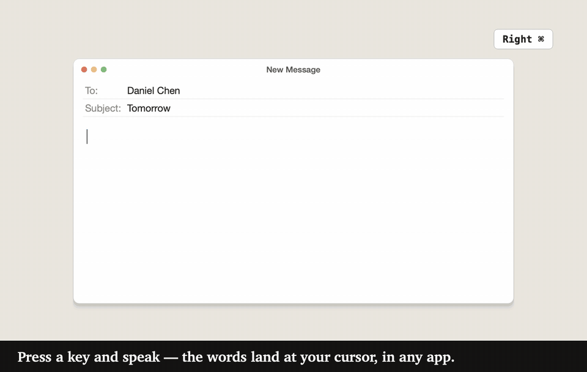

<p align="center">
  
</p>

<h1 align="center">ThunderTalk</h1>

<p align="center">
  Free, open-source voice input for macOS.<br/>
  Press a key, speak, and the text appears at your cursor.<br/>
  Speech recognition runs on your own Mac: no account, no subscription, no cloud needed.
</p>

<p align="center">
  <a href="README.zh.md">中文文档</a> · <a href="https://realallensong.github.io/ThunderTalk/">Website</a> · <a href="https://github.com/realAllenSong/ThunderTalk/releases/latest">Download</a>
</p>

<p align="center">
  <a href="LICENSE"></a>
  
  <a href="https://github.com/realAllenSong/ThunderTalk/releases/latest"></a>
  <a href="https://github.com/realAllenSong/ThunderTalk/releases"></a>
</p>

<p align="center">
  
  <br/><sub>The recording bar and Studio screens are the app's own interface (the email window is a stand-in). The dictated sentence, the meeting transcript and the speech are real model output on an M3 Max; only the pacing is scripted.</sub>
</p>

---

ThunderTalk is a voice input app for macOS. Press a hotkey in any app, say what you want to write, and the text lands where your cursor is. Recognition happens on your machine, on the Apple Silicon GPU through MLX or on the CPU through ONNX, so your audio is never sent anywhere unless you choose an optional cloud engine with your own API key. The app is free and open source (AGPL-3.0), and works as an alternative to Typeless, Wispr Flow, superwhisper and macOS Dictation.

The interface is deliberately quiet: warm paper background, near-black ink, one orange accent, and motion only where it tells you something (the live level meter, a spinner, a real progress bar).

## What's new in v1.20

- **Kokoro speaks English correctly (v1.20.1).** It used to drop the "-er" sound ("teacher" came out as "teach"); English words now come from its pronunciation dictionary. Word errors read back from its English speech: 19.4% → 0.8%.
- **A local speech API for voice agents:** `thundertalk serve` streams recognition over a WebSocket (words so far while you talk, the final text 3 ms after the pause is long enough) and speaks text back sentence by sentence over HTTP, on this Mac only. See [Speech API](#speech-api).

Last release (v1.19.0): one job queue for agents and scripts inside the app, `thundertalk batch`, background voice-overs that give way to your dictation within one step, and the AGPL-3.0.

Every release, with what was measured: [Changelog](CHANGELOG.md) · [GitHub Releases](https://github.com/realAllenSong/ThunderTalk/releases).

## Studio

Studio has Transcribe, Speak and Compose (on supported Macs).

**Transcribe.** Drop an audio or video recording (m4a, mp3, wav, mp4, mov and more) and get a timestamped transcript. Choose from your downloaded speech models; the active dictation model is selected by default. For speaker labels, select **MOSS-Transcribe-Diarize** and enable **Label speakers**; click a speaker to rename it. Selecting MOSS offers its download if needed. Export as TXT, Markdown, SRT, VTT or JSON. Common formats decode with the tools built into macOS; some formats such as WebM or MKV may need ffmpeg.

**From a link.** Paste a single-video link from YouTube, Bilibili or another site supported by yt-dlp into Studio's link field, then transcribe. yt-dlp ships with the app; you do not need to install it. The downloaded audio is transcribed on your Mac and deleted afterwards. Members-only and other sign-in restrictions are flagged; ThunderTalk does not sign in for you. If a site supplies a noticeably shorter preview than its advertised duration, Studio warns that the transcript covers only that part. Playlists, channels and live streams are not supported.

**Batch queue.** Add several files or links, choose the export formats (TXT, Markdown, SRT, VTT or JSON) and a destination folder, then select **Transcribe all**. Items run one at a time and results save automatically. You can save beside each source file instead; link results then go to Downloads. Cancel one item or the whole queue. Successful items leave the queue automatically, while failed or cancelled items remain for retry or removal. The latest transcript stays below, and every completed transcription is saved in **History**. Existing exports are kept; duplicate names get a numbered suffix.

**Subtitles in a video.** After transcribing a local video, choose **Add subtitles to video…** and pick **Burn subtitles into the video (always visible)** or **Add a subtitle track (viewer can turn on/off)**. Burned-in subtitles use white PingFang SC text on a semi-opaque dark rounded box, sized to the video, so they stay readable over busy footage and on-screen text. A subtitle track keeps the video picture unchanged. This action needs ffmpeg, which is not bundled: if you use [Homebrew](https://brew.sh/), install it with `brew install ffmpeg` in Terminal, then try again. Normal transcription of common formats does not need it. Link transcription downloads audio, so burn-in requires a local video file.

**Transcription history.** Reopen, rename, delete or search saved transcripts by title or text in Studio. Full transcripts load only when opened; the list loads 50 entries at a time. Files, links and batch items are stored under `~/.thundertalk/transcripts/<id>/` as transcript JSON and metadata, including source, duration, model, date, speaker names and generated notes.

**AI meeting notes.** After transcription, generate a short summary, key points, decisions, action items and open questions in the transcript's English or Chinese. Notes reuse the provider and model selected on the **AI Proofread** page, even with proofreading switched off; no model is downloaded. Copy or save notes as Markdown, or include them in the transcript's Markdown export. A queue checkbox generates notes after each transcription and also saves Markdown. Long transcripts use up to 16 chunks of about 6,000 characters plus one merge, with a 60-second timeout per call and Cancel. Cloud CLIs send transcript text to their provider; Ollama and LM Studio use your local server. Notes are asked to mark missing owners or deadlines as “not mentioned”. Review the generated notes against the transcript.

**Speak.** Turn text into speech with four local engines, or the voices built into macOS:

- **VoxCPM2** (OpenBMB): studio-quality 48 kHz speech and voice cloning; about real time on Apple silicon.
- **IndexTTS-2.5** (bilibili): very faithful voice cloning in Chinese, English, Japanese, Spanish and Arabic; about real time.
- **LongCat-AudioDiT 1B** (Meituan): voice cloning in Chinese and English; generates a whole piece at once, so long sentences take no longer than short ones.
- **Kokoro** (82M): small and fast (about 4 times faster than real time, on the CPU), with 23 curated voices (20 Chinese, 3 English).
- 25 built-in voices for VoxCPM2, IndexTTS and LongCat in the styles people know from short videos, vlogs and podcasts: film recap, documentary (a man's and a woman's), three explainer and two business-explainer narrations, culture talk, a witty lecturer, late-night radio, a food vlogger, news, a cool CEO, two chatty lifestyle voices, a Taiwanese accent, and English YouTuber, podcast and narrator voices. All are designed voices (created by VoxCPM2 from a text description, not recordings of real people or imitations of any platform's voices) that ship with the app.
- Every voice has a short preview: click ▶ on a voice to hear it before you generate anything. Star (☆) the ones you like to keep them in a Favourites row at the top, whichever engine they belong to.
- **Polish** (for voice-overs): each sentence is generated four times, read back by a recognizer and compared with the voice's own recording; the take that reads right, still sounds like the voice and stays in step with its neighbours is kept. About 4.5 times slower, so it is off for everyday reading.
- Pauses between sentences follow what the next sentence does (shorter before an answer, longer before a turn or a new paragraph); write `[pause 0.8]` to set one yourself. Every clip leaves at the same loudness (-16 LUFS).
- Speed control (0.75x to 1.5x) and a seekable player. Save the result as WAV (lossless) or M4A (small).
- **My voices:** record or import 5 to 15 seconds of your own voice and it can read anything you type, with VoxCPM2, IndexTTS or LongCat. A voice can keep one more recording for each way of speaking (explaining, chatting, storytelling, Chinese–English mix, openings), and Speak uses the one you pick. Adding a recording warns you about room noise or an ending cut mid-word. References are stored on your Mac in `~/.thundertalk/voices`. Please only clone voices you have the right to use.

The speech engines are one-time downloads. After that, file transcription and speech generation work offline. Optional AI notes use your chosen provider; web links and cloud providers require a connection.

### Compose

Choose **Studio ▸ Compose**, enter lyrics and describe the genre, mood and instruments for an original song with vocals and background music, or choose an instrumental. ACE-Step 1.5 runs locally on Apple Silicon; turbo is the default and recommended model on every supported tier. XL is optional for clearer lyrics and requires at least 32 GB RAM plus substantial free memory. Compose is hidden below 16 GB; on 16–23 GB Macs, turbo is experimental, with one take and a maximum of four minutes. Repaint cannot fit the 16 GB tier; use **New take** instead. Having enough total RAM does not guarantee admission: the memory guard checks current headroom before starting, and the worker yields to dictation.

After a vocal take, a local **Qwen3-ASR lyric check** flags lines that were not sung clearly. It is advisory: listen to the take before accepting it. The pronunciation helper lets you adjust the sung form of difficult words, including Latin words in Chinese lyrics, while keeping the original displayed and exported lyrics. Review the approximate time range before repainting a line, or generate a new take. Takes are saved to `~/Music/ThunderTalk`.

One-time catalog downloads include shared VAE and text-encoder weights: about **6.3 GB for turbo** or **21.5 GB for XL** (the XL checkpoint alone is about 20 GB). The optional 1.7B planner adds about **3.8 GB**, making totals about **10.1 GB / 25.3 GB**. Shared weights are reused; XL is converted to bf16 after download, so retained disk size is smaller than the download. Required runtime components and Qwen3-ASR for lyric checking are separate. See [Supported models](#supported-models).

On the measured 36 GiB M3 Max, turbo generated 60 s in about 32 s (13.0 GiB peak worker memory) and 170 s in about 71 s (13.3 GiB). XL took about 135 s and 374 s respectively (18.0 GiB peak). In the lyric read-back check, XL had 23/24 clear lines and turbo 16/24; this does not mean every word was reproduced exactly. These are measured samples, not guarantees for other Macs or songs; actual 16/24 GB hardware was not verified. [Verification details](docs/verification/2026-10-music-perf.md).

Use genre, mood and instruments for style prompts; Compose warns on real artist names and offers to remove them. When distributing to streaming platforms, disclose AI-generated music through the platform or distributor's disclosure process.

## Features

**Dictation**

- One global hotkey in any app (default Right ⌘). **Toggle** (press to start, press to stop) or **Hold to Record** (hold while you speak; quick taps and key combinations are ignored). Recording starts the moment you press.
- **The text arrives within a second, however long you speak:** finished stretches are recognized while you keep talking.
- **Live Preview** shows provisional words in the recording bar as you speak. **Esc** cancels a dictation and nothing is pasted. The bar sits at the top or bottom of the screen, or wherever you drag it, on the display you are typing on.
- Chinese, English, and both in one sentence. Spoken numbers become digits ("twenty five" → 25, "三百五十二" → 352).
- **Names come out right:** ThunderTalk ASR is trained on product names and technical terms. Add your own **hotwords** (they change only the places that sound like them), and names already in the text box you dictate into are spelled the way they are written there.
- No sentences invented from background noise, and quiet voices are kept. A dictation is never lost: long takes are recognized in pieces at your pauses, and every take is saved to **History**.
- **Recent recordings:** on by default; the last 20 dictations are kept as small audio files with their recognition details in `~/.thundertalk/recordings/`, on this Mac only (**Settings ▸ Keep recent recordings**).
- Optional: remove fillers and restarts; **AI Proofread** with the AI you already use (Codex, Claude Code, Gemini, Grok or Cursor CLI, Ollama, LM Studio, Cherry Studio or any OpenAI-compatible API; nothing is bundled); translation into 100+ languages with SeamlessM4T v2; cloud engines with your own API key.

**Speech models**

- ThunderTalk ASR 0.6B (the default, tuned for names and dictation), Qwen3-ASR 0.6B and 1.7B, Fun-ASR-Nano, SenseVoice-Small, NVIDIA Parakeet-TDT, MOSS-Transcribe-Diarize (speaker labels) and Apple's built-in recognizer (nothing to download). The app reads your hardware and recommends one; `thundertalk eval` measures them on your own Mac. Details: [Supported models](#supported-models).

**Studio:** transcribe files and links (YouTube, Bilibili and more), batch exports, subtitles, meeting notes, text to speech with cloned voices, and original songs. See [Studio](#studio).

**For agents and scripts:** the `thundertalk` command line covers every Studio feature with JSON-lines output and batches; `ThunderTalk --mcp` is an MCP server for Claude Code, Codex, Cursor and other agents. While the app is open, their jobs wait in one queue and give way to your dictation. `thundertalk serve` is a local streaming speech API for voice agents. See [Command line](#command-line).

**Everyday details**

- A guided first run: welcome, permissions, choose a model, try it, and four things worth knowing.
- Updates in one click, with a short note on what changed. Model downloads show real progress, resume after an interruption, and cancel at once.
- Optional speaker mute while recording, so the microphone does not pick up your own audio.
- A memory profile (Settings, Performance) for roughly 3 GB less RAM. Studio models free their memory after three minutes idle; dictation keeps its model resident.
- Signed with an Apple Developer ID and notarized by Apple; microphone and Accessibility permissions survive updates.

**Privacy**

- No account, no subscription, no usage limits.
- Audio is recognised on your Mac and never uploaded.
- Network traffic includes model/component downloads, GitHub update checks and fetching Studio links. AI Proofread is off by default; optional proofreading and meeting notes use your selected provider. Cloud CLIs send dictated or transcript text to that provider using your account. Ollama and LM Studio inference stays local; Cherry Studio and custom APIs may forward text to cloud models.
- The code is open. Read it, build it, fork it.

## How accurate is it?

ThunderTalk ASR 0.6B, the default model, is one of the best speech recognizers you can run on a Mac for Chinese, English and the two mixed, and the fastest of those we tested. Same recordings and the same scoring for every engine (case, punctuation and number formats ignored; Chinese compared in simplified characters), on an M3 Max, November 2026:

| Engine | Public test sets it never trained on: 120 recordings (AISHELL-1 Chinese, LibriSpeech English) | Our test set: 98 recordings, 25 min (Chinese, English, mixed; short and long) | Compute per second of audio |
| --- | --- | --- | --- |
| **ThunderTalk ASR 0.6B** (default) | **2.8%** | **8.5%** | **0.05 s** |
| Qwen3-ASR 1.7B (also in ThunderTalk) | 2.1% | 9.1% | 0.31 s |
| OpenAI gpt-4o-transcribe (cloud) | 4.4% | 12.3% | 0.22 s, network included |
| Whisper large-v3-turbo | 4.7% | 13.8% | 0.12 s |
| macOS built-in | 9.2% | 25.9% | 0.07 s |

- Error rate: word errors (English) and character errors (Chinese) per word or character of the human reference.
- The first column is the fair one: ThunderTalk ASR was trained on other public corpora (ASCEND, FLEURS, AMI). There its lead comes from Chinese (3.3%, against 6.6% for OpenAI and 7.5% for Whisper); in English the three best are within noise of each other (2.4–2.6%).
- Our own test set comes from the same public corpora as the training data (different recordings), which favours our model. OpenAI's score there is mostly its short English clips (49%): it answered Chinese speakers' English in Chinese. On long English recordings it was the most accurate of all (3.4%).
- Strong Chinese-only local models (SenseVoice, Paraformer) were not part of this comparison.

## Download

With Homebrew:

```sh
brew install --cask realallensong/tap/thundertalk
```

Or download the disk image (`.dmg`) from the [website](https://realallensong.github.io/ThunderTalk/) or [Releases](https://github.com/realAllenSong/ThunderTalk/releases/latest), open it, drag **ThunderTalk** into **Applications**, and open it from there. On first launch, grant **Microphone** and **Accessibility** access when prompted (Accessibility is what lets ThunderTalk type the text for you).

ThunderTalk is signed with an Apple Developer ID and notarised by Apple, so it opens like any other downloaded app.

## Using ThunderTalk

1. Open ThunderTalk and follow the first-run setup, or go to **Models** and download one.
2. Click into any text field in any app.
3. Press the hotkey (default **Right ⌘**), speak, and press it again. The text is pasted at the cursor.

Change the hotkey, press mode, microphone and language in **Settings**. Open **Studio** for file/link transcription, batch exports, subtitles, meeting notes, text to speech and Compose.

### Command line

**CLI v3** exposes Studio without opening a window, including URLs, mixed batches,
meeting notes, hard/soft subtitles, speech/text translation, Compose, voice cloning,
history and model setup. It can run while the app is open. From source, replace
`"$TT"` with `PYTHONPATH=$PWD python -m thundertalk`. See the
[complete command reference and Studio capability audit](docs/cli-v3.md).

```sh
TT=/Applications/ThunderTalk.app/Contents/MacOS/ThunderTalk
"$TT" --cli transcribe 'https://www.bilibili.com/list/watchlater?oid=117449840266004&bvid=BV1X6JX6sEYJ' --out talk.md --engine best --max-seconds 120
"$TT" --cli transcribe talk.m4a 'https://www.youtube.com/watch?v=jNQXAC9IVRw' --out-dir ./transcripts --formats md srt json --save-history
"$TT" --cli notes talk.md --out notes.md
"$TT" --cli burn video.mp4 --subtitles talk.srt --out subtitled.mp4 --soft
"$TT" --cli translate --text 'Hello' --source-language eng --target cmn --out translated.txt
"$TT" --cli compose --instrumental --style 'gentle piano, warm guitar' --length 10 --model turbo --planner off
"$TT" --cli speak --text 'Hello 你好' --out hi.m4a --engine best
"$TT" --cli speak --text-file script.txt --voice voxcpm2:lively-explainer-zh --polish --out voiceover.wav
"$TT" --cli voices add reference.wav --name Demo --transcript 'The words spoken in this clip.'
"$TT" --cli voices add chat.wav --to my:demo --scene chat --transcript 'What is said in the chat clip.'
"$TT" --cli voices list
"$TT" --cli voices remove my:demo
"$TT" --cli history list --query meeting
"$TT" --cli history export TRANSCRIPT_ID --out meeting.md
"$TT" --cli models list
"$TT" --cli models download qwen3-asr-06b-int8
"$TT" --cli models activate qwen3-asr-06b-int8
"$TT" --cli status
"$TT" --cli batch jobs.txt      # one job per line, e.g. transcribe a.m4a --out a.md
"$TT" --cli jobs                # what the app has queued
"$TT" --cli serve --port 8765   # local speech API (below), until Ctrl-C
```

- **Protocol:** stdout is UTF-8 JSON lines: `stage`, `progress` (`value` 0…1, or `null` for unknown size), and `result` (`ok`, output fields or stable `code` + `error`). Logs go to stderr; exit 0 means success, exit 1 means failure. Batch events carry zero-based `item` and `input`; each item has a result and the final summary has `items`, `succeeded`, `failed`. Compose returns each `take` with `metadata` and `lyric_check`, then a summary with `takes`. Read until process exit; ignore unknown fields. `status` includes `cli_version: 3` and `capabilities`.
- **Transcribe:** files and anything `links.fetch_audio` supports (YouTube, Bilibili video/watch-later/list/b23.tv). Downloads emit byte progress; results include title/source URL. Temporary media is removed on success/error/interruption. `--start`, `--end`, `--max-seconds` limit inference after downloading (require ffmpeg); timestamps are relative to the selected clip. `--engine auto` uses dictation then Apple; `best` chooses the most accurate downloaded ASR. `--speakers` uses MOSS; `--timestamps` adds TXT times; `--speaker-name S01=Name` renames speakers. Formats: txt/md/srt/vtt/json; `--notes` adds notes per input. History writes require `--save-history`.
- **Notes/translation/burn:** notes use the ready AI Proofread provider/model or `--provider`/`--model`; input may be media/URL or txt/json/md. Translation uses local SeamlessM4T, with a file/URL or `--text`/`--text-file`. Burn transcribes first when `--subtitles` is omitted; default is burn-in, `--soft` adds a subtitle track; ffmpeg is required.
- **Compose:** `--song --lyrics` or `--lyrics-file` with section tags; `--sung-lyrics` takes a JSON line-override map. Options include style, length, BPM, language, takes, seed, turbo/xl, planner on/off, and output root (default `~/Music/ThunderTalk`). Planning-token/diffusion-step events, advisory lyric checks, and nonblocking artist `warning` fields are returned. `compose lyrics/check/another/repaint/list/show/export/delete` expose the remaining processing actions. The app's hardware/memory guards apply; a v3 app's dictation has priority.
- **Libraries:** `voices add/list/rename/edit/remove`; saved voices work with `speak --voice my:ID --engine voxcpm2`, `indextts` or `longcat`, and `--scene` picks one of a voice's ways of speaking. `history list/show/export/rename/edit/delete`. `models list/download/activate` covers ASR/TTS/translation/music and optional runtimes; downloads alone enable networking for weights. Activation updates defaults for the app's next start.
- **Queue:** while the app is open, `transcribe`, `speak`, `translate`, `notes`, `burn` and `compose` run inside it, one at a time and in order, through a socket only your user can open. A transcription with the dictation model uses the engine the app already holds. No job starts while you dictate or within 1.5 s after, and closing the command (Ctrl-C, a stopped agent) cancels its job. When memory or the shared model slot is taken, a job reports `waiting` and tries again for up to `THUNDERTALK_WAIT` seconds (default 900). Without the app, commands run on their own as before; `THUNDERTALK_LOCAL=1` always does.
- **Batch:** `batch FILE` takes one job per line: a JSON argument array or a plain command line. Jobs whose `--out` already exists are skipped (`--redo` runs them), a failed job does not stop the rest (`--stop-on-error` does), and without the app each model is loaded once for the whole file. See [Batch and the job service](docs/cli-v3.md#batch-and-the-job-service--批处理与任务队列).
- **Errors:** common `bad_args`, `not_found`, `no_model`, `no_speech`, `decode`, `permission_denied`, `cancelled`, `tts_missing`, `ffmpeg_missing`, `no_provider`, `bad_transcript`, `bad_reference`, `transcript_required`, `model_busy`, `batch_failed`. Link codes remain `login` (membership/preview), `private`, `geo`, `unavailable`, `blocked`, `network`, `playlist`, `live`, `no_audio`, `missing`, `unsupported`, `other`. Compose uses `music:memory`, `music:memory_low`, `music:stalled`, `music:load_failed`, `music:failed`, `worker_stopped`. See the reference for the complete table.
- <a id="speech-api"></a>**Speech API:** `serve` runs a local server for voice agents (127.0.0.1 by default, no account, nothing leaves the Mac). `WS /v1/realtime/transcribe` takes 16 kHz PCM16 and answers with `partial` text about every 0.4 s while someone speaks and a `final` per utterance once the pause reaches `silence_ms` (default 350). `POST /v1/audio/speech` (OpenAI-style) streams speech sentence by sentence as WAV or raw PCM. `GET /v1/audio/voices` and `POST /v1/audio/transcriptions` are there too. On an M3 Max: the final came 3 ms (median) after the pause was long enough, the first partial 0.3–0.4 s after speech began, and Kokoro's first audio after 245 ms. Requests from web pages are refused. It loads its own models and runs beside the app; see the [reference](docs/cli-v3.md).
- **MCP:** `ThunderTalk --mcp` runs a stdio MCP server inside the app, so Claude Code, Codex, Cursor and other agents can use it from any project: `claude mcp add -s user thundertalk -- /Applications/ThunderTalk.app/Contents/MacOS/ThunderTalk --mcp`. Its 14 tools wrap every command (`run_batch` takes a list of jobs), and `studio_command(command, arguments)` passes any other flag. Results are one line of compact JSON, which keeps token use low. Microphone recording, playback/preview, clipboard/dialog widgets and live queue editing remain GUI interactions; the [audit](docs/cli-v3.md#studio-capability-audit--工作室功能对照) gives their reasons and CLI data equivalents.

## Supported models

### Speech recognition

| Model | Size | Backend | Languages | Accuracy | Hotwords |
|-------|------|---------|-----------|----------|----------|
| SenseVoice-Small | 241 MB | ONNX (CPU) | 5 | ★★★☆☆ | No |
| **ThunderTalk ASR 0.6B** (default, tuned Qwen3-ASR-0.6B, 8-bit, ThunderTalk Model License) | 1.2 GB | MLX (Metal GPU) | 52 | ★★★★★ | Yes |
| Qwen3-ASR-0.6B | 940 MB | ONNX (CPU) | 52 | ★★★★★ | Yes |
| Qwen3-ASR-0.6B | ~1.9 GB | MLX (Metal GPU) | 52 | ★★★★★ | Yes |
| Qwen3-ASR-1.7B | ~4.7 GB | MLX (Metal GPU) | 52 | ★★★★★ | Yes |
| MOSS-Transcribe-Diarize 0.9B | ~1.8 GB | MLX (Metal GPU) | 50+ | ★★★★★ | No |
| Parakeet-TDT 0.6B v3 | 640 MB | ONNX (CPU) | 25 (European) | ★★★★★ | No |
| Parakeet-TDT 0.6B v2 | 640 MB | ONNX (CPU) | English | ★★★★★ | No |
| Fun-ASR-Nano-2512 | 842 MB | ONNX (CPU) | Chinese, English, Japanese | ★★★★★ | Yes |
| Apple · Built in | 0 MB (part of macOS) | Speech framework (CPU / Neural Engine) | Dictation languages installed on the Mac | ★★☆☆☆ | Yes |

> **MOSS-Transcribe-Diarize** ([OpenMOSS](https://github.com/OpenMOSS/MOSS-Transcribe-Diarize), first place in the 2nd MLC-SLM Challenge at INTERSPEECH 2026) is a multi-speaker model. In dictation it pastes clean text (there is an optional S01:/S02: speaker-label toggle on its model card), and it powers Studio's Label speakers option, with speaker labels and timestamps for recordings up to about 90 minutes in a single pass.
>
> **Fun-ASR-Nano** (Alibaba Tongyi, 0.8B) runs on the CPU. On public test sets on an M3 Max it scored 7.2 % Chinese CER (Qwen3-ASR-0.6B ONNX: 6.8 %), 5.5 % English WER (7.6 %) and 15.4 % on Chinese–English mixed speech (16.4 %), and decoded 2–10 s sentences in about 0.45 s versus 0.61 s. It can invent text on pure noise. It handles about 20 s per pass, so longer dictations are recognized in pieces at your pauses.
>
> **Parakeet-TDT** (NVIDIA) runs on the CPU, with punctuation and casing built in. On an M3 Max it transcribes about 50 times faster than real time (RTF 0.019), roughly 4 times faster than Qwen3-ASR ONNX.

### Text to speech (Studio)

| Model | Size | Backend | Used for |
|-------|------|---------|----------|
| VoxCPM2 (8-bit, Apache-2.0) | 3.2 GB | MLX (Metal GPU) | Built-in voices, cloning |
| IndexTTS-2.5 (8-bit, bilibili Model Use License) | 1.7 GB + 2.3 GB encoder | MLX (Metal GPU) | Built-in voices, cloning |
| LongCat-AudioDiT 1B (8-bit, MIT) | 2.1 GB | MLX (Metal GPU) | Built-in voices, cloning (Chinese, English) |
| Kokoro v1.1 multi-lang (Apache-2.0) | 364 MB | ONNX (CPU) | 23 built-in voices (20 Chinese, 3 English) |
| Apple system voices | 0 MB (part of macOS) | AVSpeechSynthesizer (CPU) | The Chinese and English voices installed on the Mac |

Each is a one-time download offered from the Speak tab when you pick one of its voices. IndexTTS runs through a patched copy of the [mlx-indextts2](https://github.com/vanch007/mlx-indextts2) MLX port (see `third_party/README.md`).

### Music generation (Studio ▸ Compose)

| Model | Parameters | Catalog download (shared weights included) | Requirements |
|-------|------------|--------------------------------------------|--------------|
| ACE-Step 1.5 Turbo (MIT) | 2B | ~6.3 GB; ~10.1 GB with optional planner | Apple Silicon GPU; ≥16 GB RAM; default and recommended; experimental at 16–23 GB, one take, ≤4 min |
| ACE-Step 1.5 XL (MIT) | 4B | ~21.5 GB; ~25.3 GB with optional planner | Apple Silicon GPU; ≥32 GB RAM and substantial free memory; optional, clearer lyric read-back |

Downloads are one-time; both models share the VAE and text encoder. Runtime components and lyric-check ASR weights are extra. The memory guard can refuse a job even on a supported Mac. See [Compose](#compose) for measured performance and limitations.

### Translation

| Model | Size | Backend | Languages | Use case |
|-------|------|---------|-----------|----------|
| SeamlessM4T v2 Large | ~9 GB | PyTorch + MPS / CPU | 100+ | Speech and text translation in **Direct** and **Review** modes |

Translation and IndexTTS share an optional **90 MB PyTorch component**. Downloading either engine from the app also installs this component into `~/.thundertalk/runtime/`; restart once if prompted. Dictation, Studio transcription, VoxCPM2 and Kokoro need no component. Transformers and SciPy remain bundled because MLX speech uses them too. Model weights are downloaded separately from the **Models** page or the Studio engine card and stored in `~/.thundertalk/models/` or the Hugging Face cache.

### Cloud engines (optional)

Bring your own API key. Nothing is sent anywhere unless you choose one of these.

| Provider | Speech to text | Text to speech |
|----------|----------------|----------------|
| OpenAI | `gpt-transcribe`, `whisper-1` | `gpt-4o-mini-tts`, `tts-1-hd`, `tts-1` (13 voices) |
| Google Gemini | `gemini-3.8-flash` | `gemini-3.8-flash-tts`, `gemini-3.8-flash-lite-tts` (30 voices) |
| Groq | `whisper-large-v3-turbo`, `whisper-large-v3` | — |
| ElevenLabs | `scribe_v2` | `eleven_multilingual_v2` (your account's voices) |
| OpenAI-compatible | any model on your server (`/v1/audio/transcriptions`) | any model on your server (`/v1/audio/speech`) |

- **Setup:** Models ▸ Cloud APIs: paste the key and press **Test**. A self-hosted server needs only its base URL. Model and voice names are editable, so a renamed model works without an app update. OpenAI has announced that `whisper-1` and its current TTS models will be retired in early 2027.
- **Keys** are stored in the macOS Keychain (service “ThunderTalk Cloud”), never in settings or logs. Headless use can set `THUNDERTALK_OPENAI_API_KEY` (or `OPENAI_API_KEY`, `GEMINI_API_KEY`, `GROQ_API_KEY`, `ELEVENLABS_API_KEY`).
- **Dictation** through a cloud engine asks once before audio leaves your Mac. Live preview is off for cloud engines, so only the finished recording is sent. If a request fails (key, quota, network), you see the provider's message and the recording is kept.
- **Long files** are sent in pieces cut at pauses (at most 10 minutes each, FLAC), so they stay under upload limits. Subtitle timing comes from ThunderTalk's own speech detection.
- **Command line:** `thundertalk cloud set-key openai` (reads the key from stdin), `cloud list`, `cloud test openai`, `cloud set custom --base-url http://127.0.0.1:8000/v1`; then `transcribe talk.mp4 --out talk.srt --engine openai:gpt-transcribe` or `speak --text … --out a.m4a --engine gemini --voice gemini:Kore`.

## System requirements

An **Apple Silicon Mac (M1 or newer) with macOS 15 (Sequoia) or later.** The release build is arm64-only, and the speech libraries it bundles need macOS 15 (MLX), 14 (ONNX Runtime) and 13 (Qt). Intel Macs are not supported by the release build.

### Suggested models by memory

| Mac | RAM | Suggested ASR model | Translation |
|-----|-----|---------------------|-------------|
| M1 / M2 | 8 GB | SenseVoice-Small or Qwen3-ASR-0.6B | Not enough RAM for SeamlessM4T |
| M1 Pro / M2 Pro / M3 | 16 GB | ThunderTalk ASR 0.6B (default) or Qwen3-ASR-1.7B | Works, but close other heavy apps |
| Max / Ultra chips | 24 GB or more | Anything | Comfortable |

Measured on an M3 Max so far (same recordings for every model):

| Model | English WER | Chinese CER | Speed |
|-------|------------:|------------:|------:|
| Qwen3-ASR-0.6B (MLX, GPU) | 4.7 % | 5.0 % | ~11x real time |
| Qwen3-ASR-0.6B (ONNX int8, CPU) | 5.5 % | 4.5 % | ~12x |
| Parakeet-TDT 0.6B v2 (CPU) | 3.0 % | English only | ~50x |
| Parakeet-TDT 0.6B v3 (CPU) | 4.5 % | no Chinese | ~50x |
| MOSS-Transcribe-Diarize (MLX, Studio) | 3.6 % | 3.5 % | 15-21x |

Smaller chips will be slower. If you have another Mac, the numbers from `ThunderTalk --selftest` help everyone: see [#6](https://github.com/realAllenSong/ThunderTalk/issues/6).

### Disk space

- **App bundle:** about 592 MiB on disk; the zip download is about 224 MB (214 MiB). Measured against the installed v1.6.4 bundle: 961 MiB on disk and a 330 MB zip. PyTorch, torchaudio, SymPy, mpmath and NetworkX are now an optional 90 MB download shared by translation and IndexTTS. Model weights are additional.
- **Minimum to run:** about 1.1 GB (the app plus SenseVoice-Small).
- **Recommended with translation:** about 13 GB free (the app, Qwen3-ASR-0.6B, SeamlessM4T and working files).

The **Models** page shows your detected hardware and tags each model **Recommended**, **Needs Apple Silicon** or **Needs MLX**, so you do not have to memorise these tables.

## Choosing a model

| Goal | Pick |
|------|------|
| Fastest start, fewest languages | **SenseVoice-Small** (5 languages, no hotwords) |
| Most accurate and fastest dictation | **ThunderTalk ASR 0.6B (MLX 8-bit)**, our own model and the default on Apple Silicon with 16 GB or more |
| On the CPU, leaving the GPU free | **Qwen3-ASR-0.6B (ONNX int8)**, the default on 8 GB Macs |
| The original Qwen3 model on the GPU | **Qwen3-ASR-0.6B (MLX fp16)** |
| Hard accents or noisy audio | **Qwen3-ASR-1.7B (MLX fp16)**, needs 16 GB of RAM or more |
| Meetings and interviews with speaker labels | **MOSS-Transcribe-Diarize 0.9B (MLX)**, Apple Silicon only |
| Fastest English dictation | **Parakeet-TDT 0.6B v2 (ONNX int8)** |
| European languages on the CPU | **Parakeet-TDT 0.6B v3 (ONNX int8)** |
| Speak in one language, paste another | **Direct mode**, which pastes a SeamlessM4T translation after you stop |
| Speak in your language and see a translation beside it | **Review mode**: ASR transcribes, then translates, and you choose Replace or Keep original |

The author's own setup: **ThunderTalk ASR 0.6B with hotwords** for plain transcription, since it is the most accurate and the fastest; and **Review mode** with that recognizer plus **SeamlessM4T v2** when a translation is needed. Review mode translates the transcript text (text to text), which is faster than Direct mode and lets you keep the original.

## Updates

ThunderTalk checks GitHub Releases shortly after it launches and shows a small prompt when a newer version exists. **Update Now** switches to the About page, downloads the new zip, quits, swaps the bundle in `/Applications/ThunderTalk.app`, removes the quarantine attribute and relaunches. **Later** dismisses the prompt until the next launch. You can also check by hand from **About, Check for Updates**.

After an update you may need to grant **Accessibility** and **Microphone** access again; see [After an update, the hotkey or microphone stops working](#after-an-update-the-hotkey-or-microphone-stops-working).

## Troubleshooting

### Reproduce a dictation issue

`tools/replay_dictation.py RECORDING.wav` reuses the JSON sidecar's model,
language and hotwords, then prints full-clip, chunked preview and merged text.
Run it from your checkout with `PYTHONPATH=$PWD`; use the shared machine's
`~/Library/Caches/ThunderTalk-bench/lock.py gpu -- <python> tools/replay_dictation.py …`
when available. `--model`, `--language`, `--hotword`, `--step` and
`--limit-seconds` allow controlled comparisons. The replay advances simulated
audio synchronously through the same preview window/commit/guard code; it does
not reproduce timer skips or the app's slow-model shutdown. Its outputs stay local.

### A model download was interrupted

Downloads are written to a temporary file and only renamed when complete, so a half-finished download is never mistaken for a usable model, and resuming continues from where it stopped. Open **Models** and press **Download** again. If a model is marked as downloaded but crashes when activated, delete `~/.thundertalk/models/<model-id>/` and download it again.

### "Translation model not downloaded"

You chose **Direct** or **Review** mode but have not downloaded SeamlessM4T (about 9 GB). The Translation card on the Models page has a **Download** button; press it and the app fetches and loads the model.

### Studio says a model or engine is missing

The speaker model, and the voice engines for Speak, are one-time downloads. Studio shows the size and a Download button where it is needed. Fast single-speaker transcription needs a dictation model to be loaded: pick one on the Models page.

### Studio cannot fetch a link or only transcribes a preview

Use a single-video page link, not a playlist, channel or live stream. Sites may require sign-in for members-only or age-restricted videos, or reject downloads temporarily; ThunderTalk does not sign in or bypass access limits. A preview warning means the site supplied only part of the advertised recording. Transcribe a full local file you have access to instead. Links require an internet connection.

### Studio asks for ffmpeg

Burning subtitles into a video copy requires ffmpeg. Some formats, including WebM/Opus audio from links, may also need it to decode. With [Homebrew](https://brew.sh/) installed, run `brew install ffmpeg` in Terminal and retry. Common formats such as M4A, MP3, WAV, MP4 and MOV use macOS's built-in decoder.

### AI Proofread or meeting notes are unavailable

Open **AI Proofread** in the sidebar, choose a provider marked Ready and a model, and follow its action: **Verify**, **How to log in**, or start the app's local server. Proofreading must be switched on for dictation; Studio notes only need the provider/model selected. Cloud CLIs, Cherry Studio and custom APIs may send text to cloud models; Ollama and LM Studio use your local server. Failed or timed-out proofreading keeps the original text; failed notes keep the transcript. For the notes limit of 16 parts, split a very long recording and try again.

### Translation or IndexTTS asks for a component or restart

These engines need the shared optional PyTorch component (about 90 MB) as well as their model weights. Use the in-app download and restart once if prompted. Other dictation, transcription and speech engines do not need this component.

### The app opens to a blank window or a single solid colour

This is usually a Qt styling conflict. Quit, then launch from Terminal with `/Applications/ThunderTalk.app/Contents/MacOS/ThunderTalk`. If the console prints `Could not parse stylesheet`, open an issue with the output.

### The history page says 0 sessions but I had sessions yesterday

ThunderTalk reads `~/.thundertalk/history.json`. If a write was interrupted (force-quit while saving, disk full) the file can become unreadable. The app does not silently reset it; it renames the bad file to `history.broken-<timestamp>.json` next to it. Open that file in a text editor, fix the JSON, and paste the entries back into a fresh `history.json`.

### The microphone is allowed but the app says "no audio"

An old permission grant can stop matching an updated ad-hoc binary while System Settings still shows the toggle on. In onboarding, or the Home permission banner, choose **Reset and grant again**. This resets only ThunderTalk’s microphone entry and asks macOS for access again. Permission status updates automatically while the page is visible. Restricted permissions must be changed by the administrator.

### The hotkey does not start recording

ThunderTalk needs **Accessibility** permission to read global key events. Choose **Reset and grant again** for Accessibility in onboarding or Home, then enable ThunderTalk in the settings pane that opens. The app rechecks access automatically.

### First launch: "ThunderTalk can't be opened"

Releases from v1.9.2 on are notarised, so this warning should not appear. If you still see it (for example with an older download), install the latest release, or open **System Settings, Privacy & Security** and click **Open Anyway** next to the "ThunderTalk was blocked" line.

### After an update, the hotkey or microphone stops working

macOS ties these permissions to the app's signature. From v1.9.2 on, releases are signed with a Developer ID, so grants survive updates and certificate renewals; updating from v1.9.1 or earlier asks once more. If the hotkey or microphone still stops working after an update, choose **Reset and grant again** in onboarding or Home, then grant the microphone prompt or enable Accessibility in the settings pane. This clears only the selected ThunderTalk permission; no other app's grants are affected. Status is polled about once per second while the permission page is visible.

### What is the minimum machine?

Any Apple Silicon Mac with macOS 15 should run **SenseVoice-Small** (163 MB), the lightest model. Only an M3 Max has been measured so far; reports from 8 GB machines are welcome in [#6](https://github.com/realAllenSong/ThunderTalk/issues/6). Translation is unrealistic below 16 GB of RAM.

## Build from source

You need macOS, Python 3.12 or later and [uv](https://docs.astral.sh/uv/).

```bash
# Install uv (if you don't have it)
curl -LsSf https://astral.sh/uv/install.sh | sh

# Clone and install (Apple Silicon: MLX backend + translation engine)
git clone https://github.com/realAllenSong/ThunderTalk.git
cd ThunderTalk
uv sync --extra mlx --extra translation --extra indextts

# Run from source
uv run python run.py

# Build the macOS app (output: dist/ThunderTalk.app)
.venv/bin/python build_macos.py
```

### Stable local signing

Run `tools/make_signing_identity.sh` once on the build Mac. It creates **ThunderTalk Local Signing** using OpenSSL, imports its private key into a dedicated `~/Library/Keychains/ThunderTalkLocalSigning.keychain-db`, and applies user trust **for code signing only** with `security add-trusted-cert`. macOS may request your login password for the trust setting. For an unattended machine, use `THUNDERTALK_DEFER_TRUST=1 tools/make_signing_identity.sh` and rerun without that variable when you can approve the prompt. Explicit certificate-leaf requirements and `codesign --verify` work for local builds even with that global trust setting deferred.

The encrypted keychain and its random password in `~/.thundertalk/signing/keychain-password` are private, local files; never commit or distribute either. The script preserves existing keychain search entries, grants `/usr/bin/codesign` access only to the dedicated keychain, deletes scratch keys on exit, and reuses the identity rather than replacing it. Keep a secure backup of the keychain/password: replacing the certificate invalidates existing permission grants. `build_macos.py` unlocks only this dedicated keychain and automatically uses the local identity when present, with an explicit requirement for `com.thundertalk.app` and the certificate leaf. It verifies the whole bundle after signing. When the identity is absent it retains ad-hoc signing; `SIGN_IDENTITY=-` forces that fallback.

`build_macos.py` prefers a **Developer ID Application** certificate when one is in the keychain: it signs every nested binary with the hardened runtime and a secure timestamp and keeps Apple's team-based designated requirement, so permissions survive certificate renewals. With `NOTARIZE=1` it submits the app using the notarytool keychain profile `ThunderTalk-notary` (override with `NOTARY_PROFILE`; create it once with `xcrun notarytool store-credentials`), staples the ticket and checks Gatekeeper. `SIGN_IDENTITY` picks a specific identity. Each release carries two downloads of the same notarized app: `ThunderTalk-vX.Y.Z-macOS.zip` for the in-app updater and Homebrew, and `ThunderTalk-vX.Y.Z-macOS.dmg` for the website (`python -c "import build_macos; build_macos.make_dmg()"`: the app and an Applications shortcut, signed, notarized and stapled). Do not share any private key with end users.

Thread regression checks (no permission changes):

```sh
# Use lock.py gpu on shared Macs, and PYTHONPATH=$PWD with the shared interpreter.
HF_HUB_OFFLINE=1 TRANSFORMERS_OFFLINE=1 python tools/check_threaded_studio.py --preload
HF_HUB_OFFLINE=1 TRANSFORMERS_OFFLINE=1 python tools/check_threaded_studio.py --case picker
python tools/check_threaded_studio.py --streams-only
```

The public Bilibili clip is fetched through Studio’s real `TranscribeWorker` link path. The checks reuse cached Qwen 0.6B/1.7B, MOSS and VoxCPM2 weights, start dictation on another thread during inference, and exercise preload. The memory admission guard can fall back to dictation’s model; each run prints the actual model id. `--streams-only --baseline-streams` intentionally reproduces the old native CPU-stream abort in an isolated process; use it only for diagnosing the baseline.

Use all three extras for source runs and release builds so PyInstaller can analyze the complete dependencies. The release bundle excludes PyTorch and its exclusive dependencies and installs pinned wheels on demand. The optional release runtime requires Python 3.12 / Apple Silicon macOS; Intel source runs are untested.

The optional component downloads immutable Python 3.12 arm64 wheels directly from PyPI. `thundertalk/core/runtime_manifest.json` records exact versions, URLs, sizes and SHA-256 hashes from `uv.lock`: torch/torchaudio 2.11.0, SymPy 1.14.0, mpmath 1.3.0 and NetworkX 3.6.1. No pip or separately installed Python is required on the user's Mac. Downloads resume after cancellation; failed integrity checks cannot publish a runtime. An installation lock and atomic directory rename protect concurrent app instances. The app activates the wheel directory before Transformers imports; if installed in an already-running session, restart when prompted. Native dylibs remain in the original wheel-relative layout; release signing must retain the existing `disable-library-validation` entitlement.

No extra GitHub release asset is required. Attach the normal app zip; do not attach the developer environment. When updating the runtime, choose a new runtime ID, update its wheel records from `uv.lock`, rebuild, and rerun the packaged checks. Do not change a runtime ID's pins in place.

```bash
PYTHONPATH=$PWD .venv/bin/python -m pytest -q
.venv/bin/python -m ruff check thundertalk tests tools/runtime_hook.py
# Run packaged checks sequentially (use the machine GPU lock on shared machines).
APP=dist/ThunderTalk.app/Contents/MacOS/ThunderTalk
"$APP" --selftest audio
"$APP" --selftest tts --engine kokoro
"$APP" --selftest tts --engine voxcpm2
"$APP" --selftest moss --file sample.m4a
"$APP" --selftest asr --file sample.m4a
# Install and verify the optional component through the same installer as the UI.
"$APP" --selftest runtime
HF_HUB_OFFLINE=1 TRANSFORMERS_OFFLINE=1 "$APP" --selftest tts --engine indextts
HF_HUB_OFFLINE=1 TRANSFORMERS_OFFLINE=1 "$APP" --selftest translate
```

Run the first checks with no optional runtime installed and models already downloaded. The runtime check downloads about 90 MB; the final two checks need their separately downloaded model weights. `translate` checks text and speech translation using a shipped English reference clip and requires Chinese characters in both outputs. Mandarin (`cmn`) speech translation uses an English text intermediate with the same SeamlessM4T model, then translates that text to Chinese: the checkpoint can otherwise copy English speech despite the correct Chinese decoder prefix. This adds one text translation pass; other target languages use direct speech translation.

Contributions are welcome; see [CONTRIBUTING.md](CONTRIBUTING.md).

## Tech stack

- **UI:** [PySide6](https://doc.qt.io/qtforpython-6/) (Qt 6), with the colours, type and spacing defined in one theme module
- **Speech recognition:** [sherpa-onnx](https://github.com/k2-fsa/sherpa-onnx) (ONNX), [mlx-qwen3-asr](https://github.com/nicoboss/mlx-qwen3-asr) and [mlx-audio](https://github.com/Blaizzy/mlx-audio) (MLX)
- **Text to speech:** VoxCPM2 and LongCat-AudioDiT through mlx-audio, IndexTTS-2.5 through a vendored MLX port, Kokoro through sherpa-onnx; all in-process
- **Translation:** SeamlessM4T v2 through PyTorch and Transformers
- **Audio:** [sounddevice](https://python-sounddevice.readthedocs.io/) for capture; macOS `afconvert` for decoding files
- **Hotkeys:** native NSEvent on macOS
- **Build:** [PyInstaller](https://pyinstaller.org/), stable local signing when available, ad-hoc fallback

## FAQ

**Is ThunderTalk free?** Yes, for individuals and at work: no account, no subscription and no usage limits. The app code is open source under the AGPL-3.0. ThunderTalk's own models are free for personal use and for companies under 250 employees and US$10 million in revenue; larger companies, and products built on the models, need a licence (see [License](#license)).

**Does it work offline?** Yes. Once a model is downloaded, recognition, translation, file transcription and text to speech run on your Mac. Studio links need a connection. Optional AI proofreading and meeting notes depend on your chosen provider; cloud providers require a connection.

**How is it different from Typeless, Wispr Flow or superwhisper?** Those are paid, closed-source apps that typically process audio in the cloud. ThunderTalk is free and open source, with speech processed on your Mac. Optional AI proofreading and meeting notes use your selected provider; you can read the code, and your voice stays on your machine.

**Does it support Chinese and mixed Chinese-English dictation?** Yes. Qwen3-ASR handles 52 languages, including Chinese and English mixed in the same sentence, and the interface is available in English and 中文.

**Does it work on Intel Macs?** Not the release build: it is built for Apple Silicon only. Running from source on Intel with the CPU (ONNX) models has not been tested.

**Which apps does dictation work in?** Any app with a text cursor: browsers, editors, Slack, mail, terminals. ThunderTalk pastes where the cursor is.

## For companies

ThunderTalk is free for individuals, schools, non-profits and companies with fewer than 250 employees and under US$10 million in annual revenue, including at work. Larger companies need a licence to use ThunderTalk's own models at work. For a licence or any of the following, write to song@entropinia.com:

- **Managed rollout:** silent install and locked settings through your device management, with cloud engines and AI proofreading switched off so no audio or text can leave your Macs.
- **Shared vocabulary:** company-wide hotword and terminology lists.
- **Models tuned for your field:** ThunderTalk ASR trained on your product names and jargon.
- **Building ThunderTalk into your own product or service:** a commercial licence for ThunderTalk's code, its models and its local API, without the AGPL's obligation to publish your source.
- **Support** for your team.

## License

- **App code:** [GNU Affero General Public License v3.0](LICENSE). Use it, study it, change it and share it freely. If you distribute ThunderTalk or a modified version, or offer it to others as a network service, you must publish your complete source under the AGPL-3.0 as well, keep the copyright and licence notices, and keep the attribution "Based on ThunderTalk by Zhiyuan Song" in your product's about page and documentation ([NOTICE](NOTICE), section 7(b) of the licence).
- **Commercial licence for the code:** to build ThunderTalk into a closed-source product or service, or to use it without the AGPL's conditions, write to song@entropinia.com. A licence can come with support.
- **Earlier versions:** releases up to v1.18.0 were published under the MIT License and stay under it.
- **Contributions:** by sending a pull request you agree that your contribution may be distributed under the AGPL-3.0 and under ThunderTalk's commercial licences.
- **ThunderTalk's own models** (ThunderTalk ASR 0.6B): [ThunderTalk Model License](https://huggingface.co/Oulasong/ThunderTalk-ASR-0.6B/blob/main/LICENSE). Free for personal and non-commercial use, for non-profits, and inside the ThunderTalk app for companies with fewer than 250 employees and under US$10 million in annual revenue. Larger companies using them at work, building them into another commercial product or service, or offering them as a hosted service need a written licence ([contact](mailto:song@entropinia.com)).
- **Name and logo:** "ThunderTalk" and its logo identify this project. Forks and products built from the code must use their own name and logo.
- Other models keep their own licences (see [Supported models](#supported-models)).

A star or a pull request is always appreciated.

## Acknowledgments

- [sherpa-onnx](https://github.com/k2-fsa/sherpa-onnx) for cross-platform ASR inference
- [mlx-qwen3-asr](https://github.com/nicoboss/mlx-qwen3-asr) for MLX-native Qwen3 ASR
- [mlx-audio](https://github.com/Blaizzy/mlx-audio) for MLX inference of MOSS-Transcribe-Diarize and VoxCPM2
- [SenseVoice](https://github.com/FunAudioLLM/SenseVoice) for a lightweight ASR model
- [Qwen3-ASR](https://github.com/QwenLM/Qwen3-ASR) for state-of-the-art ASR
- [OpenMOSS](https://github.com/OpenMOSS/MOSS-Transcribe-Diarize) for MOSS-Transcribe-Diarize
