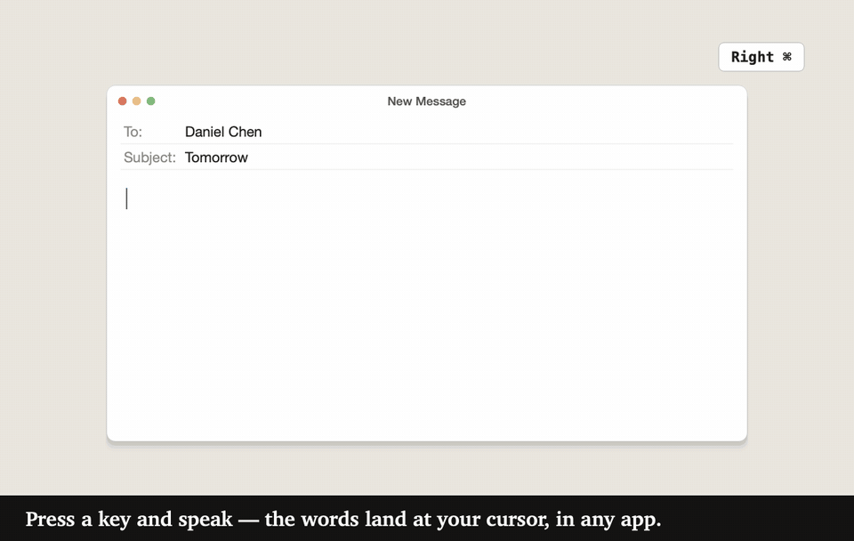

<p align="center">
  
</p>

<h1 align="center">ThunderTalk</h1>

<p align="center">
  免费开源的 macOS 语音输入应用。<br/>
  按下快捷键、开口说话，文字就出现在光标处。<br/>
  语音识别在你自己的 Mac 上完成：无需账号，无需订阅，不依赖云端。
</p>

<p align="center">
  <a href="README.md">English</a> · <a href="https://thundertalk.entropinia.com/">官网</a> · <a href="https://github.com/realAllenSong/ThunderTalk/releases/latest">下载</a>
</p>

<p align="center">
  <a href="LICENSE"></a>
  
  <a href="https://github.com/realAllenSong/ThunderTalk/releases/latest"></a>
  <a href="https://github.com/realAllenSong/ThunderTalk/releases"></a>
</p>

<p align="center">
  
  <br/><sub>录音条和工作室画面取自 App 自身界面（邮件窗口是示意）。听写的句子、会议转写和朗读语音都是模型在 M3 Max 上的真实输出，只有镜头节奏是脚本控制的。</sub>
</p>

---

ThunderTalk 是一款 macOS 语音输入应用。在任意应用里按下快捷键，说出你想写的内容，文字就落在光标所在的位置。识别在你的本机完成：通过 MLX 使用 Apple Silicon 的 GPU，或通过 ONNX 使用 CPU，所以你的录音不会发往任何地方，除非你主动选择使用自己 API 密钥的可选云端引擎。App 免费并以 AGPL-3.0 协议开源，是 **Typeless**、**Wispr Flow**、**superwhisper** 以及 macOS 自带听写的开源替代品。

界面刻意保持安静：暖色纸面背景、近黑的墨色、唯一一种橙色强调色，动效只用在有信息量的地方（实时音量条、加载圈、真实的下载进度）。

## v1.20 新功能

- **Kokoro 的英文发音修好了（v1.20.1）。**以前它会吞掉 "-er" 的音（"teacher" 读成 "teach"），现在英文单词按它自带的发音词典来读。英文朗读回读的词错误率：19.4% → 0.8%。
- **给语音 Agent 用的本地语音接口：**`thundertalk serve` 通过 WebSocket 流式识别（边说边出字，停顿够长后 3 毫秒给出整句），并通过 HTTP 一句一句地把文字读出来，只在这台 Mac 上。见[语音接口](#语音接口)。

上一版（v1.19.0）：Agent 和脚本在应用里共用一个任务队列、`thundertalk batch`、后台配音一步之内给听写让路，以及 AGPL-3.0。

每个版本的完整内容和测量数据：[更新日志](CHANGELOG.zh.md) · [GitHub Releases](https://github.com/realAllenSong/ThunderTalk/releases)。

## 工作室（Studio）

工作室包含“转写”“朗读”和“作曲”（仅在支持的 Mac 上显示）。

**转写。** 把音频或视频录音（m4a、mp3、wav、mp4、mov 等）拖进来，就能得到带时间戳的文字稿。可选择已下载的语音识别模型，默认使用当前听写模型。需要区分说话人时，选择 **MOSS-Transcribe-Diarize** 并勾选“标注说话人”；点击说话人即可改名。尚未下载 MOSS 时，选择它会启动下载。可导出为 TXT、Markdown、SRT、VTT 或 JSON。常见格式用 macOS 自带的工具解码；WebM、MKV 等部分格式可能需要 ffmpeg。

**链接转写。** 把 YouTube、Bilibili 或 yt-dlp 支持的其他网站的单个视频链接粘贴到工作室的链接输入框，再开始转写。应用已内置 yt-dlp，无需另行安装。下载的音频在你的 Mac 上转写，用完即删。会员专享及其他需要登录的限制会给出提示，ThunderTalk 不会代你登录。如果网站提供的试看片段明显短于标示的总时长，工作室会提醒文稿只包含这一部分。不支持播放列表、频道或直播。

**批量队列。** 添加多个文件或链接，选择导出格式（TXT、Markdown、SRT、VTT 或 JSON）和目标文件夹，再点“全部转写”。每次处理一项，结果自动保存。也可以选“原文件旁”，此时链接结果保存到“下载”文件夹。可取消单项或整个队列。成功项自动移出队列，失败或取消的项目保留，可重试或移除。最新文稿继续显示在下方，每份完成的转写都会保存到“历史记录”。已有导出文件会保留，重名时自动添加编号。

**视频字幕。** 本地视频转写完成后，点“给视频加字幕…”，再选择“把字幕直接印在画面上（始终可见）”或“添加字幕轨（观看时可以开关）”。印在画面上的字幕采用白色苹方文字，衬半透明深色圆角底框，字号随视频大小调整，在繁杂画面和原有文字上也清晰可读。字幕轨方式不改动原视频画面。这一步需要 ffmpeg，应用未内置：如果使用 [Homebrew](https://brew.sh/)，在终端运行 `brew install ffmpeg`，然后重试。常见格式的普通转写不需要安装它。链接转写下载的是音频，因此烧录字幕需要本地视频文件。

**转写历史记录。** 可重新打开、重命名、删除文稿，或按标题和正文搜索。列表每次加载 50 项，只在打开时读取完整文稿。文件、链接和批量转写保存在 `~/.thundertalk/transcripts/<id>/`，包含文稿 JSON 和来源、时长、模型、日期、说话人名称及生成纪要等元数据。

**AI 会议纪要。** 转写后，可按文稿的中文或英文生成摘要、要点、决定、行动项与待解决问题。纪要复用「AI 校对」页面选择的服务与模型，校对开关可保持关闭，不会下载模型。可复制或保存为 Markdown，也会纳入文稿的 Markdown 导出。队列勾选后，每项转写完成即生成纪要，并同时保存 Markdown。长文稿按约 6,000 字符分段，最多 16 段加一次合并，每次请求限 60 秒，可取消。云端 CLI 会把文稿内容发送给服务商；Ollama、LM Studio 使用本机服务。纪要会要求将未说明的负责人或期限标为「未提及」，请对照文稿核对生成的纪要。

**朗读。** 把文字读出来，可选四个本地引擎，或 macOS 自带的声音：

- **VoxCPM2**（OpenBMB）：48 kHz 录音棚音质，支持声音克隆；在 Apple 芯片上约为实时速度。
- **IndexTTS-2.5**（bilibili）：克隆还原度很高，支持中、英、日、西、阿语；约为实时速度。
- **LongCat-AudioDiT 1B**（美团）：中文和英文的声音克隆；整段一次生成，长句和短句耗时差不多。
- **Kokoro**（8200 万参数）：小巧快速（CPU 上约为实时的 4 倍），内置 23 个精选音色（20 个中文、3 个英文）。
- VoxCPM2、IndexTTS 和 LongCat 内置 25 个音色，都是短视频、Vlog、播客里常见的风格：影视解说、纪录片旁白（男声和女声）、三种科普讲解、两种商业解读、人文讲述、幽默讲堂、深夜电台、美食探店、新闻主播、霸道总裁、两种闺蜜分享、台湾腔，以及英文 YouTuber、播客和旁白。全部是“设计”出来的音色（由 VoxCPM2 根据文字描述生成，不是真人录音，也不模仿任何平台的音色），随应用一起提供。
- 每个音色都能试听：点音色上的 ▶，不用生成就能先听一听。喜欢的点 ☆ 收藏，会放在最上面的「收藏」里，不管属于哪个引擎。
- **精修**（做配音用）：每句生成四遍，用识别模型回读、和这个音色自己的录音比对声纹，留下念得对、声音没跑偏、和前后句最协调的那一遍。大约慢 4.5 倍，所以日常朗读默认不开。
- 句子之间停多久，看下一句要做什么（问题后面接回答停得短，转折和新段落停得长）；在文字里写 `[停顿 0.8]` 可以自己指定。每条配音都调到同一个响度（-16 LUFS）。
- 可调语速（0.75x 到 1.5x），带可拖动进度的播放器。结果可保存为 WAV（无损）或 M4A（体积小）。
- **我的声音：** 录制或导入 5 到 15 秒你自己的声音，就能用 VoxCPM2、IndexTTS 或 LongCat 以你的声音朗读任何内容。一个声音还可以按说法（讲解、聊天、讲故事、中英夹杂、开场）各存一段录音，朗读时用你选的那一种；添加录音时会提示底噪偏高或录音停在字中间。参考音频保存在你 Mac 上的 `~/.thundertalk/voices`。请只克隆你有权使用的声音。

语音引擎只需下载一次，之后文件转写与语音生成可离线使用。可选的 AI 纪要使用你选择的服务；网页链接和云端服务需要联网。

### 作曲（Compose）

打开**工作室 ▸ 作曲**，输入歌词，用曲风、情绪和乐器描述想要的原创歌曲，生成人声与伴奏；也可选择纯音乐。ACE-Step 1.5 在 Apple Silicon 上本地运行，turbo 在所有支持的内存档位都是默认推荐模型。XL 为可选项，歌词更清晰，需要至少 32 GB 内存及大量空闲内存。低于 16 GB 时隐藏作曲；16–23 GB Mac 仅提供实验性 turbo，限一个版本、最长四分钟。16 GB 档位无法容纳重绘，请使用**再生成一版（New take）**。总内存达标不代表一定能启动：内存保护会检查当前余量，生成进程会为听写让出资源。

每次生成人声版本后，本地 **Qwen3-ASR 歌词检查**会标出未唱清楚的行。检查仅供参考，请试听确认。发音助手可调整难读词的演唱形式，包括中文歌词中的拉丁字母词，同时保留原始显示及导出歌词。重绘一行前请核对近似时间范围，也可重新生成一个版本。作品保存在 `~/Music/ThunderTalk`。

模型目录的一次性下载包含共享 VAE 与文本编码器：**turbo 约 6.3 GB**，**XL 约 21.5 GB**（XL 检查点本身约 20 GB）。可选的 1.7B 规划模型另加约 **3.8 GB**，总量分别约 **10.1 GB / 25.3 GB**。共享权重可复用；XL 下载后转换为 bf16，保留的磁盘大小小于下载量。运行组件和歌词检查所需 Qwen3-ASR 另计。详见[支持的模型](#支持的模型)。

在 36 GiB M3 Max 上实测，turbo 生成 60 秒约需 32 秒（生成进程峰值内存 13.0 GiB），170 秒约需 71 秒（13.3 GiB）；XL 分别约需 135 秒和 374 秒（峰值均约 18.0 GiB）。歌词回读检查中，XL 有 23/24 行清晰，turbo 为 16/24；不代表每个词都完全正确。这些是样本实测，不保证其他 Mac 或歌曲相同；尚未在真实 16/24 GB 设备上验证。[验证详情](docs/verification/2026-10-music-perf.md)。

风格请用曲风、情绪和乐器描述；作曲会提醒真人艺人姓名，并提供移除选项。发布到流媒体平台时，请按平台或发行商的流程披露 AI 生成音乐。

## 功能特性

**听写**

- 一个全局快捷键，任意应用都能用（默认 Right ⌘）。**切换**（按一下开始、再按一下结束）或**长按录音**（按住说话，轻点和组合键会被忽略）。一按下就开始录音。
- **不管说多久，停下后一秒内出字：**你还在说的时候，已经说完的部分就识别好了。
- **实时预览**在录音条里显示正在说的话；按 **Esc** 取消听写，什么都不会粘贴。录音条可以放在屏幕顶部或底部，或拖到任意位置，出现在你正在输入的那块屏幕上。
- 中文、英文，以及同一句话里的中英混说。口述的数字会变成阿拉伯数字（“twenty five”变成 25，“三百五十二”变成 352）。
- **名词写得对：**ThunderTalk ASR 针对产品名和技术术语训练过。可以加自己的**热词**（只改读音像热词的地方），听写进有文字的输入框时，里面已有的名字会按框里的写法来拼。
- 不会因为背景噪音编出句子，轻声说话也不会被丢掉。听写不会丢：长段语音按停顿分段识别，每一段都保存到**历史记录**。
- **最近录音：**默认开启，最近 20 次听写以小体积音频和识别信息保存在 `~/.thundertalk/recordings/`，只在这台 Mac 上（**设置 ▸ 保留最近录音**）。
- 可选：去掉口头语和重复；用你已有的 AI 做 **AI 校对**（Codex、Claude Code、Gemini、Grok 或 Cursor CLI，Ollama、LM Studio、Cherry Studio，或任意 OpenAI 兼容 API；不内置模型）；用 SeamlessM4T v2 翻译成 100+ 种语言；用你自己的 API key 接入云端引擎。

**语音识别模型**

- ThunderTalk ASR 0.6B（默认，针对名词和听写调优）、Qwen3-ASR 0.6B 和 1.7B、Fun-ASR-Nano、SenseVoice-Small、NVIDIA Parakeet-TDT、MOSS-Transcribe-Diarize（区分说话人），以及 Apple 自带的识别（无需下载）。应用会读取你的硬件并推荐一个；`thundertalk eval` 可以在你自己的 Mac 上测它们。详见[支持的模型](#支持的模型)。

**工作室：**转写文件和链接（YouTube、Bilibili 等）、批量导出、字幕、会议纪要、用克隆的声音朗读，以及原创歌曲。见[工作室](#工作室studio)。

**给 Agent 和脚本用：**`thundertalk` 命令行覆盖工作室的全部功能，输出 JSON lines，支持批量；`ThunderTalk --mcp` 是给 Claude Code、Codex、Cursor 等 Agent 用的 MCP 服务。应用开着时，它们的任务在同一个队列里排队，并给你的听写让路。`thundertalk serve` 是给语音 Agent 用的本地流式语音接口。见[命令行](#命令行)。

**日常细节**

- 第一次运行有引导：欢迎、权限、选模型、试一试，以及四件值得知道的事。
- 一键更新，更新后会简单告诉你改了什么。模型下载显示真实进度，中断后可以续传，“取消”立即生效。
- 可选的录音时静音扬声器，避免麦克风拾取你自己的声音。
- 内存模式（“设置 → 性能”）可节省约 3 GB 内存。工作室的模型空闲三分钟后释放内存，听写模型常驻。
- 使用 Apple 开发者 ID 签名并经过 Apple 公证；麦克风和辅助功能权限在更新后不会丢失。

**隐私**

- 无账号、无订阅、无使用次数限制。
- 音频在你的 Mac 上识别，绝不上传。
- 网络用于下载模型/组件、检查 GitHub Releases 更新和获取工作室链接。AI 校对默认关闭；可选的校对与会议纪要使用你选择的服务。云端 CLI 使用你的账号，将听写或文稿文字发送给对应服务。Ollama 和 LM Studio 在本机推理；Cherry Studio 与自定义 API 可能将文字转发给云端模型。
- 代码以 AGPL-3.0 开源，可以阅读、自行构建、fork。

## 准确率如何？

默认模型 ThunderTalk ASR 0.6B 是能在 Mac 上本地运行的中文、英文及中英混合语音识别里最好的之一，也是我们测过的里面最快的。每个引擎用同样的录音、同样的计分方式（忽略大小写、标点和数字写法；中文统一按简体比较），M3 Max，2026 年 11 月：

| 引擎 | 训练时从未见过的公开测试集：120 段（AISHELL-1 中文、LibriSpeech 英文） | 我们的测试集：98 段、25 分钟（中文、英文、中英混合；长短都有） | 每秒音频的计算时间 |
| --- | --- | --- | --- |
| **ThunderTalk ASR 0.6B**（默认） | **2.8%** | **8.5%** | **0.05 秒** |
| Qwen3-ASR 1.7B（ThunderTalk 中也可选） | 2.1% | 9.1% | 0.31 秒 |
| OpenAI gpt-4o-transcribe（云端） | 4.4% | 12.3% | 0.22 秒，含网络 |
| Whisper large-v3-turbo | 4.7% | 13.8% | 0.12 秒 |
| macOS 自带 | 9.2% | 25.9% | 0.07 秒 |

- 错误率：英文按词、中文按字，相对人工参考文本计算。
- 第一列更公平：ThunderTalk ASR 是用另外几个公开语料（ASCEND、FLEURS、AMI）训练的。它领先主要在中文（3.3%，OpenAI 为 6.6%，Whisper 为 7.5%）；英文前三名相差在误差范围内（2.4–2.6%）。
- 我们自己的测试集和训练数据来自同一批公开语料（录音不同），对我们的模型有利。OpenAI 在这一列的分数主要来自短英文（49%）：它把中国人说的英文用中文写了出来。长英文录音上它是所有引擎里最准的（3.4%）。
- 这次没有比较只做中文的强力本地模型（SenseVoice、Paraformer）。

## 下载

用 Homebrew：

```sh
brew install --cask realallensong/tap/thundertalk
```

或者从[官网](https://thundertalk.entropinia.com/)或 [Releases](https://github.com/realAllenSong/ThunderTalk/releases/latest) 下载磁盘映像（`.dmg`），打开后把 **ThunderTalk** 拖进“应用程序”，再从那里打开。首次启动时按提示授予“麦克风”和“辅助功能”权限（“辅助功能”让 ThunderTalk 能替你把文字输入到光标处）。

ThunderTalk 使用 Apple 开发者 ID 签名并经过 Apple 公证，下载后可以像其他应用一样直接打开。

## 使用方法

1. 打开 ThunderTalk，按首次运行引导操作，或进入“模型”页下载一个模型。
2. 点进任意应用里的任意输入框。
3. 按下快捷键（默认 **Right ⌘**），说话，再按一次结束，文字会粘贴到光标处。

在“设置”里可以修改快捷键、按键模式、麦克风和界面语言。打开“工作室”可以转写文件/链接、批量导出、制作字幕、生成会议纪要、文字转语音和作曲。

### 命令行

**CLI v3** 无需窗口即可使用工作室功能：网址、混合批处理、会议笔记、烧录/软字幕、
语音/文字翻译、作曲、声音克隆、历史和模型管理，可与应用同时运行。从源码使用时，
将 `"$TT"` 替换为 `PYTHONPATH=$PWD python -m thundertalk`。
详见[完整命令参考及工作室功能对照](docs/cli-v3.md)。

```sh
TT=/Applications/ThunderTalk.app/Contents/MacOS/ThunderTalk
"$TT" --cli transcribe 'https://www.bilibili.com/list/watchlater?oid=117449840266004&bvid=BV1X6JX6sEYJ' --out talk.md --engine best --max-seconds 120
"$TT" --cli transcribe talk.m4a 'https://www.youtube.com/watch?v=jNQXAC9IVRw' --out-dir ./transcripts --formats md srt json --save-history
"$TT" --cli notes talk.md --out notes.md
"$TT" --cli burn video.mp4 --subtitles talk.srt --out subtitled.mp4 --soft
"$TT" --cli translate --text 'Hello' --source-language eng --target cmn --out translated.txt
"$TT" --cli compose --instrumental --style 'gentle piano, warm guitar' --length 10 --model turbo --planner off
"$TT" --cli speak --text 'Hello 你好' --out hi.m4a --engine best
"$TT" --cli voices add reference.wav --name Demo --transcript 'The words spoken in this clip.'
"$TT" --cli voices list
"$TT" --cli voices remove my:demo
"$TT" --cli history list --query meeting
"$TT" --cli history export TRANSCRIPT_ID --out meeting.md
"$TT" --cli models list
"$TT" --cli models download qwen3-asr-06b-int8
"$TT" --cli models activate qwen3-asr-06b-int8
"$TT" --cli status
"$TT" --cli batch jobs.txt      # 每行一条任务，例如 transcribe a.m4a --out a.md
"$TT" --cli jobs                # 应用里排着的任务
"$TT" --cli serve --port 8765   # 本地语音接口（见下），Ctrl-C 结束
```

- **协议：** stdout 仅输出 UTF-8 JSON 行：`stage`、`progress`（`value` 为 0…1，未知总量时为 `null`）、`result`（`ok`、输出字段或固定 `code` + `error`）。日志写 stderr；成功退出 0，失败退出 1。批处理事件含从 0 开始的 `item` 和原始 `input`，逐项返回结果，最后汇总 `items`、`succeeded`、`failed`。作曲逐版本返回 `take`、`metadata` 和 `lyric_check`，最后汇总 `takes`。应读到进程退出，并忽略未知字段。`status` 含 `cli_version: 3` 和能力列表。
- **转写：** 支持本地文件及 `links.fetch_audio` 的所有网址，包括 YouTube、Bilibili 视频/稍后再看/列表/b23.tv。提供下载字节进度及结果标题、网址，成功、失败或中断都会清理临时音频。`--start`、`--end`、`--max-seconds` 在完整下载后限制推理，需 ffmpeg；时间戳相对所选片段。`auto` 沿用听写模型再回退 Apple；`best` 选最准确的已下载模型；`--speakers` 用 MOSS；`--timestamps` 为 TXT 加时间，`--speaker-name S01=名字` 改名。支持 txt/md/srt/vtt/json；`--notes` 逐项生成笔记，`--save-history` 才保存历史。
- **笔记、翻译、字幕：** 笔记沿用 AI 校对中已就绪的服务/模型，可用 `--provider`、`--model` 覆盖，输入支持媒体、网址或 txt/json/md。翻译使用本地 SeamlessM4T，支持媒体/网址和 `--text`/`--text-file`。字幕未传 `--subtitles` 时先转写；默认烧录，`--soft` 为可选字幕轨，需 ffmpeg。
- **作曲：** `--song --lyrics` 或 `--lyrics-file` 支持段落标签，`--sung-lyrics` 读取 JSON 整行演唱覆盖。可设风格、时长、BPM、语言、版本数、种子、turbo/xl、规划开关和输出根目录（默认 `~/Music/ThunderTalk`）。返回规划 token/扩散步数进度、建议性歌词检查和不阻塞的艺人名 `warning`。`compose lyrics/check/another/repaint/list/show/export/delete` 提供其余操作，沿用内存保护；v3 应用听写优先。
- **资源库：** `voices add/list/rename/edit/remove`；`speak --voice my:ID --engine voxcpm2` 或 `indextts` 可用保存的声音。`history list/show/export/rename/edit/delete`；`models list/download/activate` 覆盖识别、朗读、翻译、作曲及可选运行组件。只有显式下载会联网获取权重；激活保存为应用下次启动的默认配置。
- **队列：** 应用开着时，`transcribe`、`speak`、`translate`、`notes`、`burn`、`compose` 在应用里按先后一次一个地运行，经由只有当前用户能打开的套接字。用听写模型转写时直接用应用已经加载的引擎。听写时及结束后 1.5 秒内不开始任务；关掉命令（Ctrl-C、停掉的 Agent）即取消它的任务。内存或共享模型槽被占时，任务报告 `waiting` 并重试，最长 `THUNDERTALK_WAIT` 秒（默认 900）。没开应用时照旧在本进程运行；`THUNDERTALK_LOCAL=1` 始终如此。
- **批处理：** `batch FILE` 每行一条任务：JSON 参数数组或普通命令行。`--out` 已存在的任务会跳过（`--redo` 重跑），一条失败不影响其余（`--stop-on-error` 则停下），没开应用时每个模型整批只加载一次。见[批处理与任务队列](docs/cli-v3.md#batch-and-the-job-service--批处理与任务队列)。
- **错误码：** 常见 `bad_args`、`not_found`、`no_model`、`no_speech`、`decode`、`permission_denied`、`cancelled`、`tts_missing`、`ffmpeg_missing`、`no_provider`、`bad_transcript`、`bad_reference`、`transcript_required`、`model_busy`、`batch_failed`。网址沿用 `login`（会员/预览）、`private`、`geo`、`unavailable`、`blocked`、`network`、`playlist`、`live`、`no_audio`、`missing`、`unsupported`、`other`。作曲使用 `music:memory`、`music:memory_low`、`music:stalled`、`music:load_failed`、`music:failed`、`worker_stopped`，完整错误表见参考。
- <a id="语音接口"></a>**语音接口：** `serve` 启动一个给语音 Agent 用的本地服务（默认 127.0.0.1，无需账号，数据不出这台 Mac）。`WS /v1/realtime/transcribe` 接收 16 kHz PCM16，说话期间约每 0.4 秒返回一次 `partial`，停顿达到 `silence_ms`（默认 350）后返回该句的 `final`。`POST /v1/audio/speech`（OpenAI 风格）按句流式返回 WAV 或原始 PCM。另有 `GET /v1/audio/voices` 和 `POST /v1/audio/transcriptions`。M3 Max 实测：停顿够长后 final 中位数 3 毫秒送达，开口后 0.3–0.4 秒出第一段 partial，Kokoro 245 毫秒出第一段音频。来自网页的请求会被拒绝。它自己加载模型，和应用并行运行；详见[参考文档](docs/cli-v3.md)。
- **MCP：** `ThunderTalk --mcp` 在应用内启动 stdio MCP 服务，Claude Code、Codex、Cursor 等智能体在任何项目里都能用：`claude mcp add -s user thundertalk -- /Applications/ThunderTalk.app/Contents/MacOS/ThunderTalk --mcp`。14 个工具覆盖所有命令（`run_batch` 一次交一批任务），`studio_command(command, arguments)` 可传其余参数。结果是单行紧凑 JSON，省 token。麦克风录制、播放/预听、剪贴板/对话框控件及运行中队列编辑保留在 GUI，原因和命令行替代数据见[功能对照](docs/cli-v3.md#studio-capability-audit--工作室功能对照)。

## 支持的模型

### 语音识别（ASR）

| 模型 | 大小 | 后端 | 语言 | 准确度 | 热词 |
|------|------|------|------|--------|------|
| SenseVoice-Small | 241 MB | ONNX (CPU) | 5 | ★★★☆☆ | 否 |
| **ThunderTalk ASR 0.6B**（默认，Qwen3-ASR-0.6B 调优，8 位，ThunderTalk 模型许可证） | 1.2 GB | MLX (Metal GPU) | 52 | ★★★★★ | 是 |
| Qwen3-ASR-0.6B | 940 MB | ONNX (CPU) | 52 | ★★★★★ | 是 |
| Qwen3-ASR-0.6B | ~1.9 GB | MLX (Metal GPU) | 52 | ★★★★★ | 是 |
| Qwen3-ASR-1.7B | ~4.7 GB | MLX (Metal GPU) | 52 | ★★★★★ | 是 |
| MOSS-Transcribe-Diarize 0.9B | ~1.8 GB | MLX (Metal GPU) | 50+ | ★★★★★ | 否 |
| Parakeet-TDT 0.6B v3 | 640 MB | ONNX (CPU) | 25（欧洲语言） | ★★★★★ | 否 |
| Parakeet-TDT 0.6B v2 | 640 MB | ONNX (CPU) | 英语 | ★★★★★ | 否 |
| Fun-ASR-Nano-2512 | 842 MB | ONNX (CPU) | 中文、英文、日文 | ★★★★★ | 是 |
| Apple · 系统自带 | 0 MB（macOS 自带） | Speech 框架（CPU / 神经网络引擎） | 本机已安装的听写语言 | ★★☆☆☆ | 是 |

> **MOSS-Transcribe-Diarize**（[OpenMOSS](https://github.com/OpenMOSS/MOSS-Transcribe-Diarize)，INTERSPEECH 2026 第二届 MLC-SLM 挑战赛第一名）是多说话人模型。听写时它粘贴纯文本（模型卡片上有可选的 S01:/S02: 说话人标签开关），同时它也驱动工作室的“标注说话人”选项，单次即可转写最长约 90 分钟的录音，并附说话人标签和时间戳。
>
> **Fun-ASR-Nano**（阿里通义，0.8B）以 CPU 运行。在 M3 Max 上用公开测试集测得：中文字错率 7.2%（Qwen3-ASR-0.6B ONNX 为 6.8%），英文词错率 5.5%（7.6%），中英混说错误率 15.4%（16.4%）；2–10 秒短句识别约 0.45 秒，Qwen3 约 0.61 秒。在纯噪音上可能凭空输出文字。它单次约处理 20 秒，更长的听写会在你停顿处分段识别。
>
> **Parakeet-TDT**（NVIDIA）以 CPU 运行，自带标点和大小写。在 M3 Max 上识别速度约为实时的 50 倍（RTF 0.019），约为 Qwen3-ASR ONNX 的 4 倍。

### 文字转语音（工作室）

| 模型 | 大小 | 后端 | 用途 |
|------|------|------|------|
| VoxCPM2（8-bit，Apache-2.0） | 3.2 GB | MLX (Metal GPU) | 内置音色、声音克隆 |
| IndexTTS-2.5（8-bit，bilibili 模型使用许可） | 1.7 GB + 2.3 GB 编码器 | MLX (Metal GPU) | 内置音色、声音克隆 |
| LongCat-AudioDiT 1B（8-bit，MIT） | 2.1 GB | MLX (Metal GPU) | 内置音色、声音克隆（中文、英文） |
| Kokoro v1.1 多语言版（Apache-2.0） | 364 MB | ONNX (CPU) | 23 种内置音色（20 种中文、3 种英文） |

都是一次性下载：在“朗读”里选中某个引擎的音色时，应用会提示下载。IndexTTS 使用打过补丁的 [mlx-indextts2](https://github.com/vanch007/mlx-indextts2) MLX 移植版（见 `third_party/README.md`）。

### 音乐生成（工作室 ▸ 作曲）

| 模型 | 参数量 | 目录下载量（含共享权重） | 要求 |
|------|--------|------------------------|------|
| ACE-Step 1.5 Turbo（MIT） | 2B | ~6.3 GB；加可选规划模型 ~10.1 GB | Apple Silicon GPU；≥16 GB 内存；默认推荐；16–23 GB 为实验性，限一个版本、≤4 分钟 |
| ACE-Step 1.5 XL（MIT） | 4B | ~21.5 GB；加可选规划模型 ~25.3 GB | Apple Silicon GPU；≥32 GB 内存及大量空闲内存；可选，歌词回读更清晰 |

均为一次性下载，共用 VAE 与文本编码器。运行组件及歌词检查的 ASR 权重另计。支持的 Mac 也可能因当前内存不足而被拒绝启动。实测性能及限制见[作曲](#作曲compose)。

### 翻译

| 模型 | 大小 | 后端 | 语言 | 用途 |
|------|------|------|------|------|
| SeamlessM4T v2 Large | ~9 GB | PyTorch + MPS / CPU | 100+ | 在“直译”“审阅”模式下进行语音与文本翻译 |

翻译和 IndexTTS 共用一个按需下载的 **90 MB PyTorch 组件**。在应用内下载这两个引擎时，组件会安装到 `~/.thundertalk/runtime/`；出现提示后请重启一次。听写、工作室转写、VoxCPM2 和 Kokoro 无需该组件。MLX 语音也使用 Transformers 和 SciPy，因此这两个库仍内置。模型权重从“模型”页面或工作室引擎卡片另行下载，存放在 `~/.thundertalk/models/` 或 Hugging Face 缓存中。

### 云端引擎（可选）

使用你自己的 API 密钥。除非你选择其中之一，否则不会发送任何数据。

| 服务商 | 语音转文字 | 文字转语音 |
|--------|------------|------------|
| OpenAI | `gpt-transcribe`、`whisper-1` | `gpt-4o-mini-tts`、`tts-1-hd`、`tts-1`（13 种声音） |
| Google Gemini | `gemini-3.8-flash` | `gemini-3.8-flash-tts`、`gemini-3.8-flash-lite-tts`（30 种声音） |
| Groq | `whisper-large-v3-turbo`、`whisper-large-v3` | — |
| ElevenLabs | `scribe_v2` | `eleven_multilingual_v2`（你账户中的声音） |
| 兼容 OpenAI 的服务 | 服务上的任意模型（`/v1/audio/transcriptions`） | 服务上的任意模型（`/v1/audio/speech`） |

- **设置：**在「模型 ▸ 云端接口」粘贴密钥并点击**测试**。自建服务只需填写接口地址。模型名和声音名都可以修改，服务商改名后无需更新应用。OpenAI 已宣布 `whisper-1` 和现有 TTS 模型将于 2027 年初停用。
- **密钥**保存在 macOS 钥匙串（服务名 “ThunderTalk Cloud”），不会写入设置或日志。无界面使用时可设置 `THUNDERTALK_OPENAI_API_KEY`（或 `OPENAI_API_KEY`、`GEMINI_API_KEY`、`GROQ_API_KEY`、`ELEVENLABS_API_KEY`）。
- **听写**首次使用云端引擎时会先确认，因为录音会离开你的 Mac。云端引擎不使用实时预览，只发送完整录音。请求失败（密钥、额度、网络）时会显示服务商的提示，录音会保留。
- **长文件**会在停顿处切成多段发送（每段最长 10 分钟，FLAC 格式），不会超过上传限制。字幕时间来自 ThunderTalk 自己的语音检测。
- **命令行：**`thundertalk cloud set-key openai`（从标准输入读取密钥）、`cloud list`、`cloud test openai`、`cloud set custom --base-url http://127.0.0.1:8000/v1`；之后可用 `transcribe talk.mp4 --out talk.srt --engine openai:gpt-transcribe` 或 `speak --text … --out a.m4a --engine gemini --voice gemini:Kore`。

## 系统要求

**需要 Apple Silicon（M1 或更新）的 Mac，以及 macOS 15（Sequoia）或更高版本。** 发布版只为 arm64 构建，内置的语音库分别需要 macOS 15（MLX）、14（ONNX Runtime）和 13（Qt）。发布版不支持 Intel Mac。

### 按内存建议的模型

| Mac | 内存 | 建议的识别模型 | 翻译 |
|-----|------|----------------|------|
| M1 / M2 | 8 GB | SenseVoice-Small 或 Qwen3-ASR-0.6B | 内存不够跑 SeamlessM4T |
| M1 Pro / M2 Pro / M3 | 16 GB | ThunderTalk ASR 0.6B（默认）或 Qwen3-ASR-1.7B | 可以，但请关掉其他重型应用 |
| Max / Ultra 芯片 | 24 GB 及以上 | 都可以 | 宽裕 |

目前只在 M3 Max 上实测过（所有模型用同一批录音）：

| 模型 | 英文词错率 | 中文字错率 | 速度 |
|------|----------:|----------:|-----:|
| Qwen3-ASR-0.6B（MLX，GPU） | 4.7% | 5.0% | 约实时的 11 倍 |
| Qwen3-ASR-0.6B（ONNX int8，CPU） | 5.5% | 4.5% | 约 12 倍 |
| Parakeet-TDT 0.6B v2（CPU） | 3.0% | 仅英文 | 约 50 倍 |
| Parakeet-TDT 0.6B v3（CPU） | 4.5% | 不支持中文 | 约 50 倍 |
| MOSS-Transcribe-Diarize（MLX，工作室） | 3.6% | 3.5% | 15–21 倍 |

芯片越小越慢。如果你有别的 Mac，`ThunderTalk --selftest` 的结果对大家都很有用，见 [#6](https://github.com/realAllenSong/ThunderTalk/issues/6)。

### 磁盘空间

- **App 本体：** 磁盘占用约 592 MiB，zip 下载约 224 MB（214 MiB）。实测已安装的 v1.6.4 为 961 MiB，zip 为 330 MB。PyTorch、torchaudio、SymPy、mpmath 和 NetworkX 改为翻译与 IndexTTS 共用的可选组件，下载约 90 MB。模型权重另计。
- **最低运行需求：** 约 1.1 GB（App + SenseVoice-Small）。
- **含翻译的推荐配置：** 约 13 GB 空闲空间（App + Qwen3-ASR-0.6B + SeamlessM4T + 工作文件）。

“模型”页面会显示检测到的硬件，并为每个模型标注“推荐”“需要 Apple Silicon”或“需要 MLX”，无需记忆上面的表格。

## 选择模型

| 目标 | 选择 |
|------|------|
| 启动最快、语言最少 | **SenseVoice-Small**（5 种语言，无热词） |
| 听写最准、最快 | **ThunderTalk ASR 0.6B (MLX 8 位)**，我们自己的模型，16 GB 及以上 Apple Silicon Mac 的默认模型 |
| 在 CPU 上运行、不占 GPU | **Qwen3-ASR-0.6B (ONNX int8)**，8 GB Mac 的默认模型 |
| GPU 上运行的 Qwen3 原版 | **Qwen3-ASR-0.6B (MLX fp16)** |
| 重口音或嘈杂音频 | **Qwen3-ASR-1.7B (MLX fp16)**，需要 16 GB 及以上内存 |
| 带说话人标签的会议 / 访谈 | **MOSS-Transcribe-Diarize 0.9B (MLX)**，仅 Apple Silicon |
| 最快的英语听写 | **Parakeet-TDT 0.6B v2 (ONNX int8)** |
| CPU 上的欧洲语言 | **Parakeet-TDT 0.6B v3 (ONNX int8)** |
| 说一种语言，粘贴另一种 | **直译模式**，结束录音后粘贴 SeamlessM4T 的译文 |
| 用母语说话，同时看到译文 | **审阅模式**：ASR 转写后再翻译，由你选择替换或保留原文 |

作者自己的配置：纯转写用 **ThunderTalk ASR 0.6B + 热词**，最准也最快；需要翻译时用**审阅模式**，以它作为识别引擎，搭配 **SeamlessM4T v2**。审阅模式翻译的是转写后的文本（文本到文本），比直译模式快，并且能保留原文。

## 自动更新

ThunderTalk 启动后不久会检查 GitHub Releases，发现新版本就弹出一个小提示。点“立即更新”后，应用会跳转到“关于”页，下载新版本的 zip，退出、替换 `/Applications/ThunderTalk.app`、移除 quarantine 属性，然后自动重启。点“以后再说”则本次启动内不再提示。你也可以在“关于 → 检查更新”里手动检查。

更新之后可能需要重新授予“辅助功能”和“麦克风”权限，见下文 [自动更新后快捷键 / 麦克风失灵](#自动更新后快捷键--麦克风失灵)。

## 故障排查

### 模型下载中断了

下载器先写入临时文件，完成后才重命名，所以未完成的下载不会被当成可用模型，续传也会从中断处继续。在“模型”页再点一次“下载”即可。如果模型已标记为已下载但激活时崩溃，请删除 `~/.thundertalk/models/<模型 ID>/` 后重新下载。

### “Translation model not downloaded”（翻译模型未下载）

你选了“直译”或“审阅”模式，但还没下载 SeamlessM4T（约 9 GB）。“模型”页的翻译卡片上有“下载”按钮，点击后应用会自动下载并加载。

### 工作室提示缺少模型或引擎

说话人模型和“朗读”所需的语音引擎都是一次性下载。工作室会在需要的地方显示大小和下载按钮。单人快速转写需要先加载一个听写模型：请到“模型”页选一个。

### 工作室无法获取链接，或只转写了试看片段

请使用单个视频的页面链接，不要使用播放列表、频道或直播。会员专享、年龄限制视频等可能要求登录，网站也可能暂时拒绝下载；ThunderTalk 不会代你登录或绕过访问限制。试看片段警告表示网站只提供了标示总时长中的一部分。可改为转写你有权访问的完整本地文件。链接需要联网。

### 工作室提示需要 ffmpeg

把字幕烧录进视频副本需要 ffmpeg。部分格式（包括链接下载的 WebM/Opus 音频）解码时也可能需要它。安装 [Homebrew](https://brew.sh/) 后，在终端运行 `brew install ffmpeg`，然后重试。M4A、MP3、WAV、MP4、MOV 等常见格式使用 macOS 自带的解码工具。

### AI 校对或会议纪要不可用

在侧边栏打开「AI 校对」，选择标为「已就绪」的服务和模型，并按卡片上的提示操作：「验证」「如何登录」或启动应用的本机服务。听写校对需要打开开关；工作室纪要只需选好服务和模型。云端 CLI、Cherry Studio 和自定义 API 可能把文字发送给云端模型；Ollama 和 LM Studio 使用本机服务。校对失败或超时会保留原文，纪要失败会保留文稿。若纪要超过 16 段限制，请拆分很长的录音后重试。

### 翻译或 IndexTTS 提示需要组件或重启

这两个引擎除模型权重外，还需要共用的可选 PyTorch 组件（约 90 MB）。请用应用内下载，出现提示后重启一次。其他听写、转写和语音引擎无需该组件。

### 应用打开后是空白窗口或纯色

通常是 Qt 样式冲突。退出应用，从终端启动：`/Applications/ThunderTalk.app/Contents/MacOS/ThunderTalk`。如果控制台打印 `Could not parse stylesheet`，请把输出贴到 issue 里。

### 历史页显示“0 次”，但昨天明明用过

ThunderTalk 读取 `~/.thundertalk/history.json`。如果某次写入被中断（保存时强制退出、磁盘满），文件可能损坏。应用不会静默清空它，而是把损坏文件改名为同目录下的 `history.broken-<时间戳>.json`。用文本编辑器打开它，修复 JSON 后把内容粘贴回新的 `history.json` 即可。

### 麦克风权限明明开了，应用还是说“no audio”

临时签名版本更新后，旧授权可能失效，而系统设置中的开关仍显示开启。请在首次引导或首页权限提示中选择“重置并重新授权”，然后允许系统弹出的麦克风请求。此操作仅清除 ThunderTalk 的对应授权；页面可见时会自动检查状态。受管理限制的权限需要管理员更改。

### 快捷键不触发录音

ThunderTalk 需要“辅助功能”权限来读取全局键盘事件。在首次引导或首页选择辅助功能的“重置并重新授权”，然后在自动打开的系统设置中开启 ThunderTalk。应用会自动重新检查授权，无需重启。

### 首次打开提示“无法打开 / 无法验证开发者”

从 v1.9.2 起的版本都经过公证，正常不会出现这个提示。如果仍然看到（例如用的是旧版下载），请安装最新版，或打开“系统设置 → 隐私与安全性”，点“ThunderTalk 已被阻止使用”旁边的“仍要打开”。

### 自动更新后快捷键 / 麦克风失灵

macOS 把这些权限和应用的签名绑定。从 v1.9.2 起，正式版使用开发者 ID 签名，更新和证书续期后权限都会保留；从 v1.9.1 或更早版本更新时会再请求一次。如果更新后快捷键或麦克风仍然失灵，请在首次引导或首页点击“重置并重新授权”，允许麦克风请求或在打开的系统设置中开启辅助功能。仅重置 ThunderTalk 的对应权限，不影响其他应用；权限页面可见时约每秒自动检查一次。

### 最低能跑什么配置？

任何装了 macOS 15 的 Apple Silicon Mac 应该都能跑最轻的 **SenseVoice-Small**（163 MB）。目前只在 M3 Max 上实测过，欢迎在 [#6](https://github.com/realAllenSong/ThunderTalk/issues/6) 分享 8 GB 机器的结果。内存低于 16 GB 时翻译不现实。

## 从源码构建

需要 macOS、Python 3.12 或更高版本，以及 [uv](https://docs.astral.sh/uv/)。

```bash
# 安装 uv（如果还没有）
curl -LsSf https://astral.sh/uv/install.sh | sh

# 克隆并安装（Apple Silicon：MLX 后端 + 翻译引擎）
git clone https://github.com/realAllenSong/ThunderTalk.git
cd ThunderTalk
uv sync --extra mlx --extra translation --extra indextts

# 从源码运行
uv run python run.py

# 打包 macOS 应用（产物：dist/ThunderTalk.app）
.venv/bin/python build_macos.py
```

源码运行和发布构建请使用 `uv sync --extra mlx --extra translation --extra indextts`，保留完整开发依赖供 PyInstaller 分析。发布包会排除 PyTorch 及其专用依赖，并通过锁定的 wheel 按需安装。发布版的可选组件仅支持 Python 3.12 / Apple Silicon macOS。Intel Mac 源码运行路径未经测试。

可选组件直接从 PyPI 下载固定的 Python 3.12 arm64 wheel。`thundertalk/core/runtime_manifest.json` 保存从 `uv.lock` 提取的准确版本、URL、大小和 SHA-256：torch/torchaudio 2.11.0、SymPy 1.14.0、mpmath 1.3.0、NetworkX 3.6.1。用户无需安装 pip 或 Python。取消后可续传，校验失败不会发布组件。安装锁与原子目录重命名保护多个应用实例。应用启动时先激活组件，再导入 Transformers；在当前会话安装后，按提示重启。原生 dylib 保持 wheel 中的相对布局；发布签名须保留已有的 `disable-library-validation` entitlement。

无需新增 GitHub Release 附件，只需发布正常的 app zip。更新组件时，使用新的 runtime ID，从 `uv.lock` 更新 wheel 清单，重新构建并运行打包自检；不要原地修改同一个 ID 的版本。

```bash
PYTHONPATH=$PWD .venv/bin/python -m pytest -q
.venv/bin/python -m ruff check thundertalk tests tools/runtime_hook.py
# 顺序运行打包自检；共享机器上使用机器级 GPU 锁。
APP=dist/ThunderTalk.app/Contents/MacOS/ThunderTalk
"$APP" --selftest audio
"$APP" --selftest tts --engine kokoro
"$APP" --selftest tts --engine voxcpm2
"$APP" --selftest moss --file sample.m4a
"$APP" --selftest asr --file sample.m4a
# 使用与 UI 相同的代码下载并验证可选组件。
"$APP" --selftest runtime
HF_HUB_OFFLINE=1 TRANSFORMERS_OFFLINE=1 "$APP" --selftest tts --engine indextts
HF_HUB_OFFLINE=1 TRANSFORMERS_OFFLINE=1 "$APP" --selftest translate
```

前几项检查应在未安装可选组件、已下载模型权重时运行。runtime 检查下载约 90 MB；最后两项另需模型权重。translate 使用内置英文参考音频检查文本与语音翻译，并要求两项输出都包含汉字。普通话（cmn）语音翻译先通过同一个 SeamlessM4T 模型生成英文中间文本，再将文本翻译为中文：模型权重在使用正确中文解码前缀时仍可能照抄英文语音。这会增加一次文本翻译推理；其他目标语言仍直接进行语音翻译。

欢迎贡献代码，详见 [CONTRIBUTING.md](CONTRIBUTING.md)。

### 稳定的本地签名

在构建 Mac 上运行一次 `tools/make_signing_identity.sh`。脚本通过 OpenSSL 创建 **ThunderTalk Local Signing**，将私钥导入专用钥匙串 `~/Library/Keychains/ThunderTalkLocalSigning.keychain-db`，并仅为代码签名设置信任。macOS 可能要求输入登录密码。无人值守时可使用 `THUNDERTALK_DEFER_TRUST=1 tools/make_signing_identity.sh`，有条件确认系统提示后再去掉该变量运行。暂缓全局信任时，固定证书的本地签名与 `codesign --verify` 仍可正常使用。

钥匙串与随机密码文件 `~/.thundertalk/signing/keychain-password` 仅存于本机，严禁提交或分发。脚本保留现有钥匙串搜索列表，仅配置专用钥匙串的签名工具访问权，退出时删除临时私钥，并复用已有身份。请安全备份这两个文件，替换证书会使旧授权失效。构建脚本自动解锁此专用钥匙串，签名要求明确绑定 `com.thundertalk.app` 与证书；身份缺失时保留临时签名回退。`SIGN_IDENTITY=-` 可强制临时签名。

`build_macos.py` 在钥匙串中有 **Developer ID Application** 证书时优先使用它：为每个内嵌二进制文件加上强化运行时与安全时间戳签名，并保留 Apple 基于团队的签名要求，证书续期后权限不会丢失。设置 `NOTARIZE=1` 时，会用 notarytool 钥匙串配置 `ThunderTalk-notary`（可用 `NOTARY_PROFILE` 覆盖；先用 `xcrun notarytool store-credentials` 创建一次）提交公证、附加公证票据并检查 Gatekeeper。每个版本带同一个已公证应用的两种下载：`ThunderTalk-vX.Y.Z-macOS.zip` 给应用内更新和 Homebrew 用，`ThunderTalk-vX.Y.Z-macOS.dmg` 给官网下载用（`python -c "import build_macos; build_macos.make_dmg()"`：内含应用和“应用程序”快捷方式，已签名、公证并附加票据）。`SIGN_IDENTITY` 可指定签名身份。不要把任何私钥交给用户。

线程回归工具 `tools/check_threaded_studio.py` 使用公开哔哩哔哩音频，经过 Studio 的真实链接工作线程路径，测试听写模型、模型选择器、MOSS 说话人标注，以及推理期间的另线程听写和 TTS 预加载。共享 Mac 上须通过 `lock.py gpu` 执行，并设置 `PYTHONPATH=$PWD`、`HF_HUB_OFFLINE=1` 与 `TRANSFORMERS_OFFLINE=1`。`--preload` 测试预加载，`--case picker` 单独验证另一模型，`--streams-only` 验证惰性 CPU 数组跨线程转换。内存保护可能回退到听写模型，输出会记录实际模型。`--streams-only --baseline-streams` 会故意重现旧版原生崩溃，仅用于诊断。

## 技术栈

- **UI：** [PySide6](https://doc.qt.io/qtforpython-6/)（Qt 6），颜色、字体和间距集中定义在一个主题模块里
- **语音识别：** [sherpa-onnx](https://github.com/k2-fsa/sherpa-onnx)（ONNX）、[mlx-qwen3-asr](https://github.com/nicoboss/mlx-qwen3-asr) 与 [mlx-audio](https://github.com/Blaizzy/mlx-audio)（MLX）
- **文字转语音：** VoxCPM2 和 LongCat-AudioDiT（mlx-audio）、IndexTTS-2.5（内置的 MLX 移植版）、Kokoro（sherpa-onnx），全部在进程内运行
- **翻译：** 通过 PyTorch 与 Transformers 运行的 SeamlessM4T v2
- **音频：** 采集用 [sounddevice](https://python-sounddevice.readthedocs.io/)，文件解码用 macOS 自带的 `afconvert`
- **快捷键：** macOS 原生 NSEvent
- **打包：** [PyInstaller](https://pyinstaller.org/)，可用时采用稳定的本地签名，否则临时签名

## 常见问题

**ThunderTalk 收费吗？** 个人和工作中使用都不收费：无账号、无订阅、无使用次数限制。App 代码以 AGPL-3.0 协议开源。ThunderTalk 自有模型对个人和员工少于 250 人且年收入低于 1000 万美元的公司免费；更大的公司以及基于模型做产品，需要授权（见[许可证](#许可证)）。

**能离线使用吗？** 可以。模型下载完成后，识别、翻译、文件转写和文字转语音都在你的 Mac 上运行。工作室链接需要联网。可选的 AI 校对与会议纪要取决于你选择的服务，云端服务需要联网。

**和 Typeless、Wispr Flow、superwhisper 有什么区别？** 它们是付费闭源应用，通常在云端处理音频。ThunderTalk 免费、开源，语音在你的 Mac 上处理。可选的 AI 校对与会议纪要使用你选择的服务；你可以阅读代码，语音数据也不会离开你的电脑。

**支持中文和中英混说吗？** 支持。Qwen3-ASR 支持 52 种语言，包括同一句话里中英混说，界面也有中文和英文两种语言。

**Intel Mac 能用吗？** 发布版不行：它只为 Apple Silicon 构建。在 Intel 上从源码运行 CPU（ONNX）模型没有测试过。

**可以在哪些应用里听写？** 任何有文字光标的应用：浏览器、编辑器、Slack、邮件、终端。光标在哪里，文字就粘贴到哪里。

## 企业使用

ThunderTalk 对个人、学校、非营利组织，以及员工少于 250 人且年收入低于 1000 万美元的公司免费，在工作中使用也一样。规模更大的公司在工作中使用 ThunderTalk 自有模型需要授权。授权或以下服务，请联系 song@entropinia.com：

- **统一部署：**通过公司的设备管理静默安装、锁定设置，并关闭云端引擎和 AI 校对，确保音频和文字都不会离开公司的 Mac。
- **共享词汇：**全公司统一的热词和术语表。
- **行业专属模型：**用你们的产品名和行业术语训练的 ThunderTalk ASR。
- **把 ThunderTalk 集成进你们自己的产品或服务：**ThunderTalk 模型及本地接口的商业授权。
- 为团队提供**技术支持**。

## 许可证

- **App 代码：**[GNU Affero 通用公共许可证 v3.0](LICENSE)。可以自由使用、研究、修改和分享。如果你分发 ThunderTalk 或修改后的版本，或把它作为网络服务提供给他人，必须同样以 AGPL-3.0 公开全部源代码，保留版权和许可声明，并在产品的关于页和文档里保留“Based on ThunderTalk by Zhiyuan Song”的署名（[NOTICE](NOTICE)，依据许可证第 7(b) 条）。
- **代码的商业授权：**如果要把 ThunderTalk 集成到闭源产品或服务中，或不想受 AGPL 条件约束，请写信到 song@entropinia.com。授权可附带技术支持。
- **早期版本：**v1.18.0 及之前的版本以 MIT 协议发布，仍按 MIT 协议使用。
- **贡献：**提交 Pull Request 即表示你同意你的贡献可以按 AGPL-3.0 和 ThunderTalk 的商业授权分发。
- **ThunderTalk 自有模型**（ThunderTalk ASR 0.6B）：[ThunderTalk 模型许可证](https://huggingface.co/Oulasong/ThunderTalk-ASR-0.6B/blob/main/LICENSE)。个人和非商业用途、非营利组织免费；员工少于 250 人且年收入低于 1000 万美元的公司在 ThunderTalk App 内使用免费。规模更大的公司在工作中使用、集成到其他商业产品或服务、或作为托管服务提供，需要书面授权（[联系](mailto:song@entropinia.com)）。
- **名称和标志：**“ThunderTalk”名称和标志代表本项目。基于代码的 fork 和产品须使用自己的名称和标志。
- 其他模型沿用各自的许可证（见[支持的模型](#支持的模型)）。

给个 Star 或提个 PR 就是对项目最好的支持。

## 致谢

- [sherpa-onnx](https://github.com/k2-fsa/sherpa-onnx)：跨平台 ASR 推理
- [mlx-qwen3-asr](https://github.com/nicoboss/mlx-qwen3-asr)：MLX 原生的 Qwen3 ASR
- [mlx-audio](https://github.com/Blaizzy/mlx-audio)：MOSS-Transcribe-Diarize 与 VoxCPM2 的 MLX 推理
- [SenseVoice](https://github.com/FunAudioLLM/SenseVoice)：轻量级 ASR 模型
- [Qwen3-ASR](https://github.com/QwenLM/Qwen3-ASR)：业界领先的 ASR 模型
- [OpenMOSS](https://github.com/OpenMOSS/MOSS-Transcribe-Diarize)：MOSS-Transcribe-Diarize

### 复现听写问题

在项目目录中使用 `PYTHONPATH=$PWD <python> tools/replay_dictation.py RECORDING.wav`，
工具读取同名 JSON 中的模型、语言和热词，输出整段识别、分块预览和合并结果。
共享机器上应通过 `~/Library/Caches/ThunderTalk-bench/lock.py gpu -- <命令>` 运行；
已下载模型可设置 `HF_HUB_OFFLINE=1 TRANSFORMERS_OFFLINE=1`。
`--model`、`--language`、`--hotword`、`--step`、`--limit-seconds` 可用于对比。
工具同步模拟音频推进，复用预览的窗口、提交和循环保护逻辑，不模拟定时器跳帧或慢模型停用；输出仅保存在本机。
